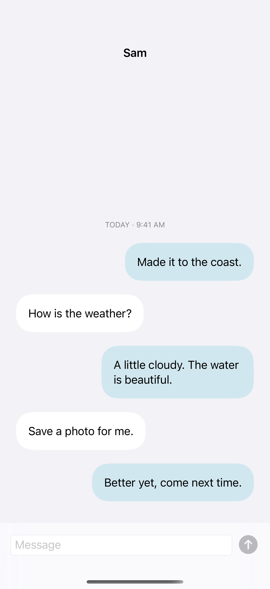
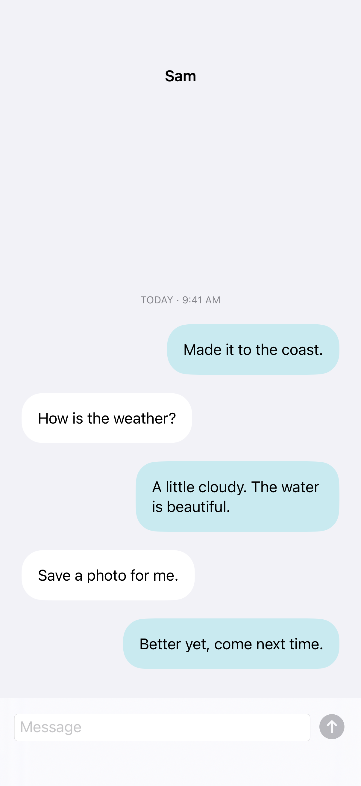

# Bottom-anchored conversations

A bottom scroll anchor starts a conversation at its newest content; explicit scrolling can follow new messages when appropriate.

## SwiftUI

```swift
import SwiftUI

struct LatestMessages: View {
    @State private var messages = ["Hello", "Welcome back"]
    var body: some View {
        ScrollViewReader { proxy in
            ScrollView {
                VStack {
                    ForEach(messages.indices, id: \.self) { index in
                        Text(messages[index]).padding().id(index)
                    }
                }.frame(maxWidth: .infinity)
            }
            .defaultScrollAnchor(.bottom)
            .onChange(of: messages.count) { _, _ in
                withAnimation { proxy.scrollTo(messages.count - 1, anchor: .bottom) }
            }
            .safeAreaInset(edge: .bottom) {
                Button("Add reply") { messages.append("A new message") }.padding()
            }
        }
    }
}
```

## Captures

<!-- captures:start -->
### iPhone 16 Pro · iOS 18.5

default. light appearance; Large text; en_US.



### iPhone 17 Pro · iOS 26.5

default. light appearance; Large text; en_US.



### iPhone 18 Pro · iOS 27.0

default. light appearance; Large text; en_US.


<!-- captures:end -->

## Full example

[Open the complete runnable example](BottomAnchoredChatDemo.swift).

## Reference

[Apple: defaultScrollAnchor](https://developer.apple.com/documentation/swiftui/view/defaultscrollanchor(_:)).
