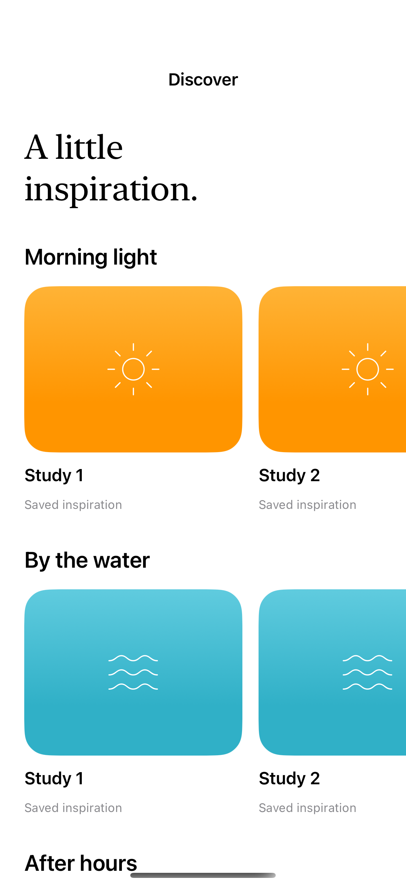
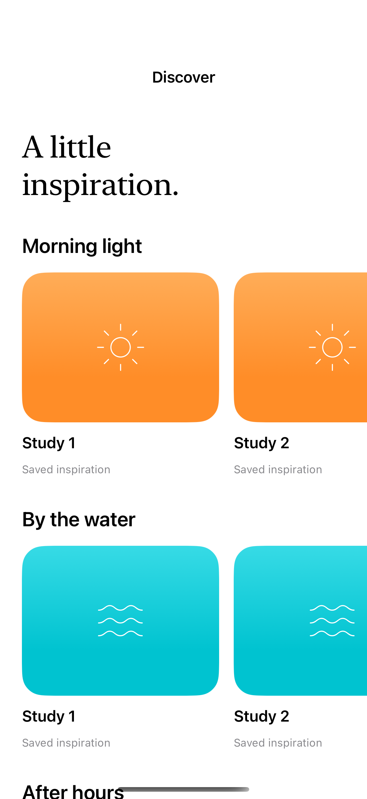

# Nested scrolling and carousels

Nested scroll views let a page move vertically while each shelf scrolls horizontally through its own collection.

## SwiftUI

```swift
import SwiftUI

struct Shelves: View {
    var body: some View {
        ScrollView {
            LazyVStack(spacing: 24) {
                ForEach(0..<5) { shelf in
                    ScrollView(.horizontal) {
                        LazyHStack {
                            ForEach(0..<8) { item in
                                Text("\(shelf + 1).\(item + 1)")
                                    .frame(width: 180, height: 140)
                                    .background(.teal.opacity(0.15), in: RoundedRectangle(cornerRadius: 20))
                            }
                        }.padding(.horizontal)
                    }
                }
            }
        }
    }
}
```

## Captures

<!-- captures:start -->
### iPhone 16 Pro · iOS 18.5

default. light appearance; Large text; en_US.



### iPhone 17 Pro · iOS 26.5

default. light appearance; Large text; en_US.


<!-- captures:end -->

## Full example

[Open the complete runnable example](NestedScrollingDemo.swift).

## Reference

[Apple: ScrollView](https://developer.apple.com/documentation/swiftui/scrollview).
