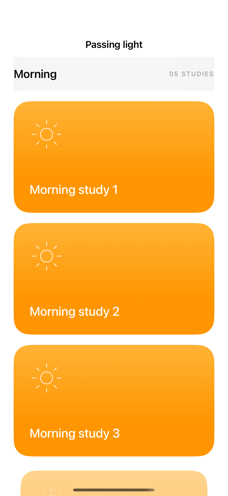
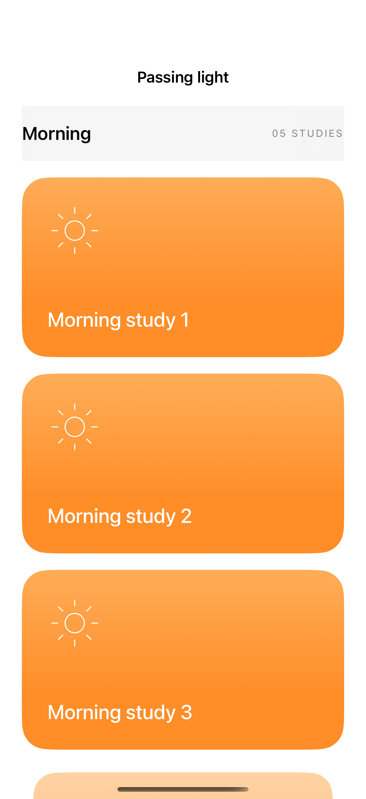

# Pinned headers and scroll effects

Pinned section headers keep a section’s title visible, while scroll transitions can change a card as it enters or leaves the viewport.

## SwiftUI

```swift
import SwiftUI

struct PinnedSections: View {
    var body: some View {
        ScrollView {
            LazyVStack(pinnedViews: [.sectionHeaders]) {
                ForEach(["Morning", "Evening"], id: \.self) { title in
                    Section {
                        ForEach(1...12, id: \.self) { number in
                            Text("Study \(number)").padding(32)
                        }
                    } header: {
                        Text(title).font(.headline)
                            .frame(maxWidth: .infinity).padding()
                            .background(.regularMaterial)
                    }
                }
            }
        }
    }
}
```

## Captures

<!-- captures:start -->
### iPhone 16 Pro · iOS 18.5

default. light appearance; Large text; en_US.



### iPhone 17 Pro · iOS 26.5

default. light appearance; Large text; en_US.


<!-- captures:end -->

## Full example

[Open the complete runnable example](PinnedHeadersScrollEffectsDemo.swift).

## Reference

[Apple: LazyVStack](https://developer.apple.com/documentation/swiftui/lazyvstack).
