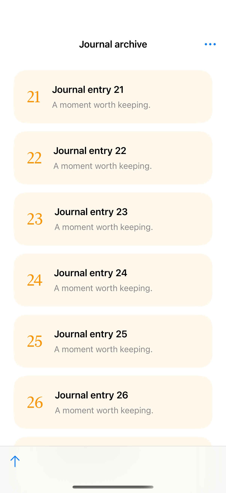
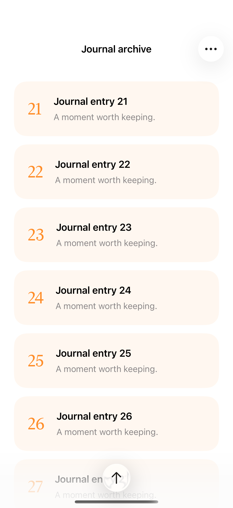

# Preserving a scroll target

Stable item identifiers let a scroll-position binding keep its anchored row visible as earlier items are inserted.

## SwiftUI

```swift
import SwiftUI

struct StableScrollTarget: View {
    @State private var items = Array(21...50)
    @State private var visible: Int? = 21
    var body: some View {
        ScrollView {
            LazyVStack {
                ForEach(items, id: \.self) { number in
                    Text("Entry \(number)").padding().id(number)
                }
            }.scrollTargetLayout()
        }
        .scrollPosition(id: $visible, anchor: .top)
        .safeAreaInset(edge: .bottom) {
            Button("Insert earlier entries") {
                guard let first = items.first, first > 1 else { return }
                items.insert(contentsOf: Array(1..<first), at: 0)
            }.padding()
        }
    }
}
```

## Captures

<!-- captures:start -->
### iPhone 16 Pro · iOS 18.5

default. light appearance; Large text; en_US.



### iPhone 17 Pro · iOS 26.5

default. light appearance; Large text; en_US.


<!-- captures:end -->

## Full example

[Open the complete runnable example](PreservingScrollTargetDemo.swift).

## Reference

[Apple: scrollPosition](https://developer.apple.com/documentation/swiftui/view/scrollposition(id:anchor:)).
