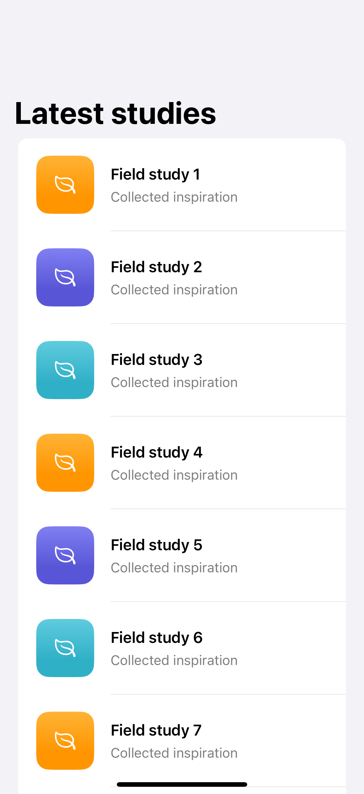
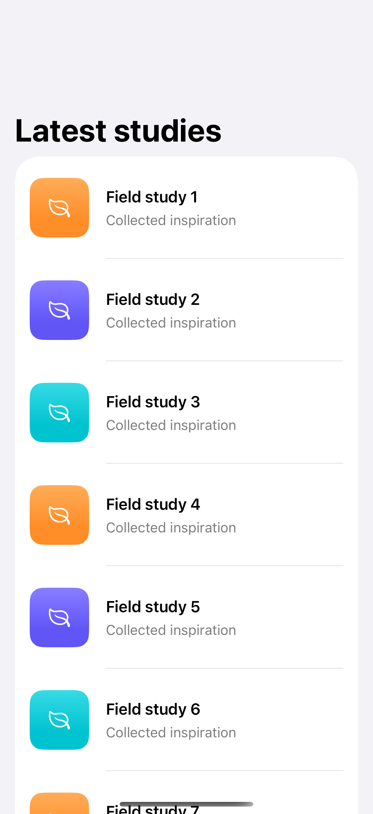
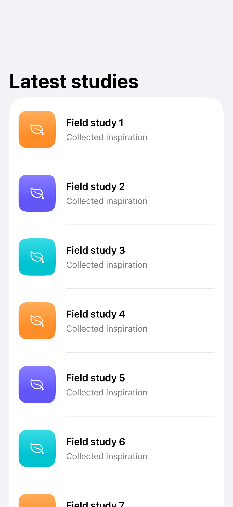

# Refresh and pagination

Pull-to-refresh and a lazy end marker can load data incrementally; this example uses delayed local fixtures so it works offline.

## SwiftUI

```swift
import SwiftUI

struct RefreshableList: View {
    @State private var revision = 0
    var body: some View {
        List(1...20, id: \.self) { number in
            Text("Study \(number) · revision \(revision)")
        }
        .refreshable {
            do { try await Task.sleep(for: .milliseconds(500)) }
            catch { return }
            revision += 1
        }
    }
}
```

## Captures

<!-- captures:start -->
### iPhone 16 Pro · iOS 18.5

default. light appearance; Large text; en_US.



### iPhone 17 Pro · iOS 26.5

default. light appearance; Large text; en_US.



### iPhone 18 Pro · iOS 27.0

default. light appearance; Large text; en_US.


<!-- captures:end -->

## Full example

[Open the complete runnable example](RefreshPaginationDemo.swift).

## Reference

[Apple: refreshable](https://developer.apple.com/documentation/swiftui/view/refreshable(action:)).
