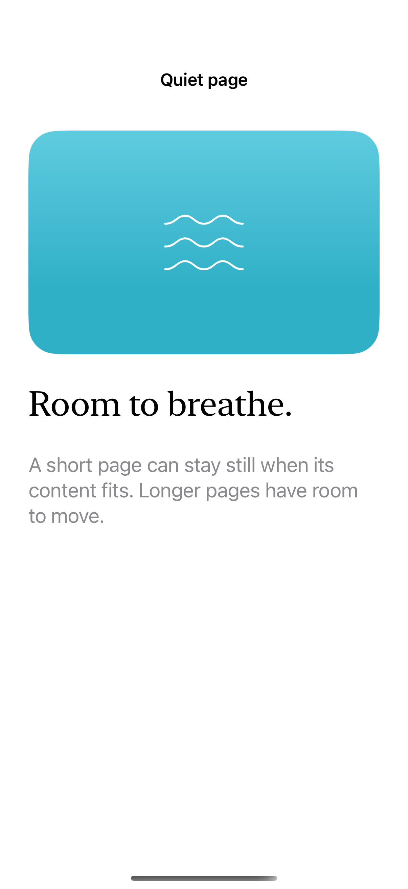
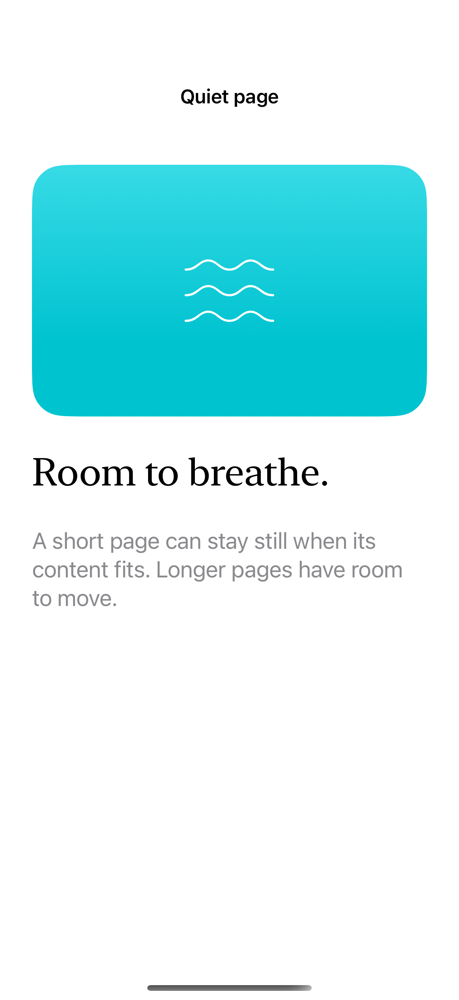

# Bounce and scroll indicators

Scroll bounce can depend on content size, while indicator visibility and flashing provide a separate cue that more content is available.

## SwiftUI

```swift
import SwiftUI

struct ContentSizedBounce: View {
    @State private var flash = 0
    var body: some View {
        ScrollView { Text("A short page").padding(32) }
            .scrollBounceBehavior(.basedOnSize)
            .scrollIndicators(.visible)
            .scrollIndicatorsFlash(trigger: flash)
            .safeAreaInset(edge: .bottom) {
                Button("Flash indicators") { flash += 1 }.padding()
            }
    }
}
```

## Captures

<!-- captures:start -->
### iPhone 16 Pro · iOS 18.5

default. light appearance; Large text; en_US.



### iPhone 17 Pro · iOS 26.5

default. light appearance; Large text; en_US.


<!-- captures:end -->

## Full example

[Open the complete runnable example](ScrollBounceIndicatorsDemo.swift).

## Reference

[Apple: scrollBounceBehavior](https://developer.apple.com/documentation/swiftui/view/scrollbouncebehavior(_:axes:)).
