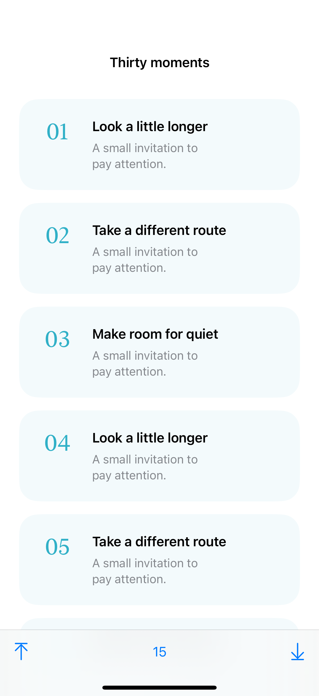
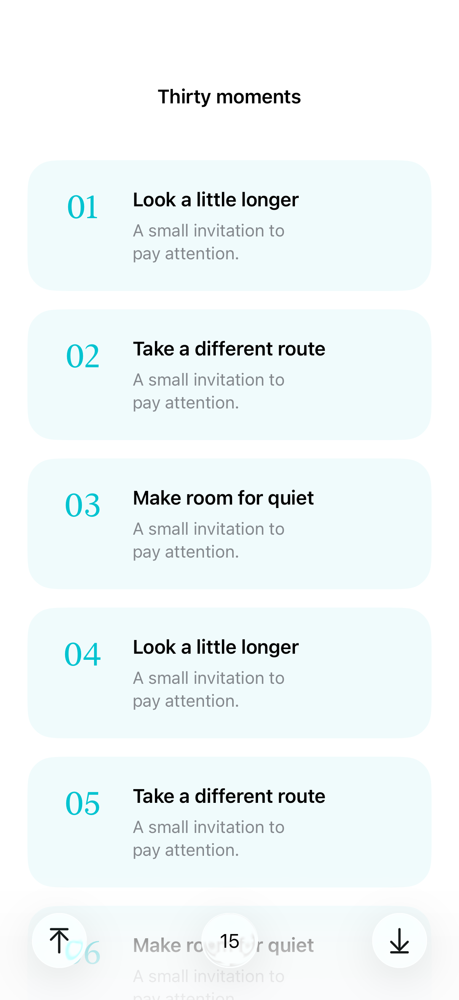
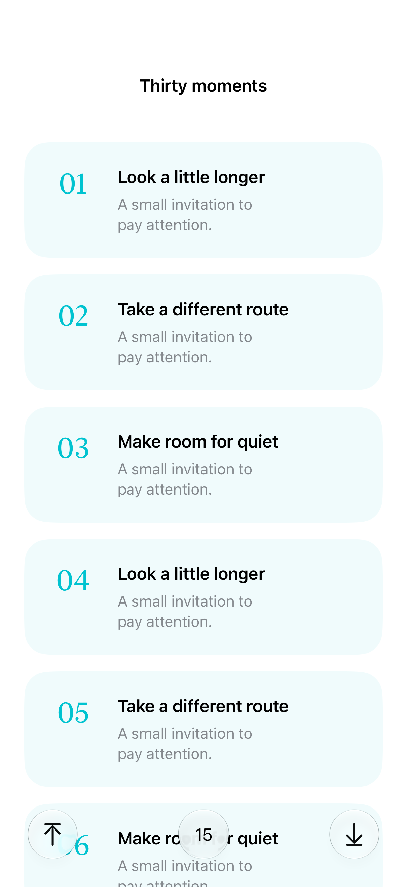

# Programmatic scroll position

A scroll-position binding can move a scroll view to a stable item identifier, an edge, or an explicit content offset.

## SwiftUI

```swift
import SwiftUI

struct JumpToItem: View {
    @State private var position = ScrollPosition(idType: Int.self)
    var body: some View {
        ScrollView {
            LazyVStack {
                ForEach(1...50, id: \.self) { number in
                    Text("Item \(number)").padding().id(number)
                }
            }.scrollTargetLayout()
        }
        .scrollPosition($position)
        .safeAreaInset(edge: .bottom) {
            Button("Jump to 25") {
                withAnimation { position.scrollTo(id: 25, anchor: .center) }
            }.padding()
        }
    }
}
```

## Captures

<!-- captures:start -->
### iPhone 16 Pro · iOS 18.5

default. light appearance; Large text; en_US.



### iPhone 17 Pro · iOS 26.5

default. light appearance; Large text; en_US.



### iPhone 18 Pro · iOS 27.0

default. light appearance; Large text; en_US.


<!-- captures:end -->

## Full example

[Open the complete runnable example](ScrollPositionDemo.swift).

## Reference

[Apple: ScrollPosition](https://developer.apple.com/documentation/swiftui/scrollposition).
