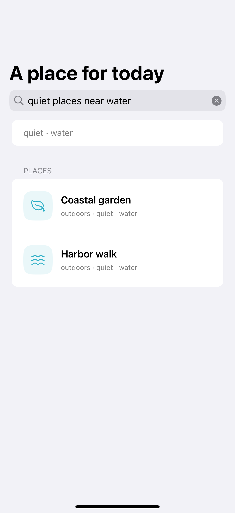
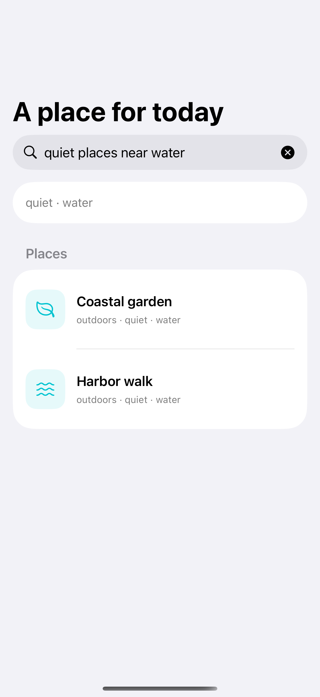
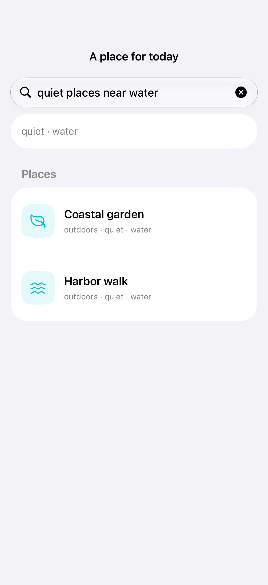

# Phrase search patterns

A small local keyword matcher can turn familiar phrases into explicit search filters.

## SwiftUI

```swift
import SwiftUI

struct LocalPhraseSearch: View {
    @State private var query = ""
    private let places = ["Harbor walk": Set(["quiet", "water"]), "Courtyard café": Set(["coffee", "outdoors"])]
    private var tags: Set<String> {
        Set(["quiet", "water", "coffee", "outdoors"].filter { query.localizedCaseInsensitiveContains($0) })
    }

    var body: some View {
        NavigationStack {
            List(places.keys.sorted().filter {
                query.isEmpty || (!tags.isEmpty && tags.isSubset(of: places[$0] ?? [])) || $0.localizedCaseInsensitiveContains(query)
            }, id: \.self) { Text($0) }
            .searchable(text: $query, prompt: "Try quiet places near water")
        }
    }
}
```

## Captures

<!-- captures:start -->
### iPhone 16 Pro · iOS 18.5

default. light appearance; Large text; en_US.



### iPhone 17 Pro · iOS 26.5

default. light appearance; Large text; en_US.



### iPhone 18 Pro · iOS 27.0

default. light appearance; Large text; en_US.


<!-- captures:end -->

## Full example

[Open the complete runnable example](KeywordSearchPhrasesDemo.swift).

## Reference

[Apple: searchable](https://developer.apple.com/documentation/swiftui/view/searchable(text:placement:prompt:)).
