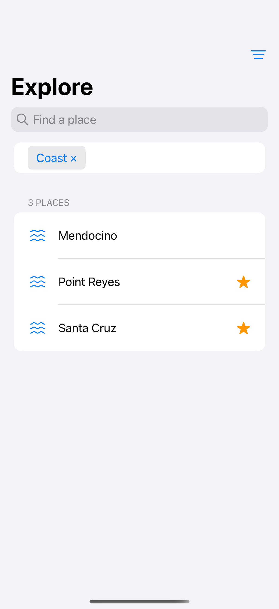
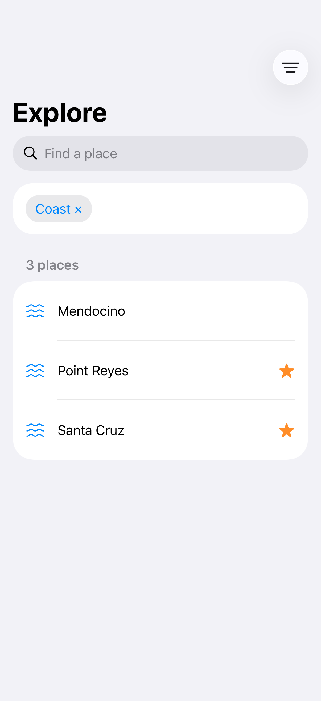

# Search filters

Filters combine with a text query and expose the constraints that remain active.

## SwiftUI

```swift
import SwiftUI

struct FilteredSearch: View {
    @State private var query = ""
    @State private var favoritesOnly = false
    private let places = ["Big Sur", "Carmel", "Point Reyes"]
    private let favorites: Set<String> = ["Big Sur"]

    var body: some View {
        NavigationStack {
            List {
                Toggle("Favorites only", isOn: $favoritesOnly)
                ForEach(places.filter {
                    (!favoritesOnly || favorites.contains($0)) &&
                    (query.isEmpty || $0.localizedCaseInsensitiveContains(query))
                }, id: \.self) { Text($0) }
            }
            .searchable(text: $query)
        }
    }
}
```

## Captures

<!-- captures:start -->
### iPhone 16 Pro · iOS 18.5

default. light appearance; Large text; en_US.



### iPhone 17 Pro · iOS 26.5

default. light appearance; Large text; en_US.


<!-- captures:end -->

## Full example

[Open the complete runnable example](SearchFiltersDemo.swift).

## Reference

[Apple: searchable](https://developer.apple.com/documentation/swiftui/view/searchable(text:placement:prompt:)).
