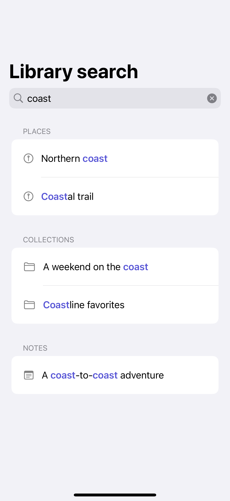
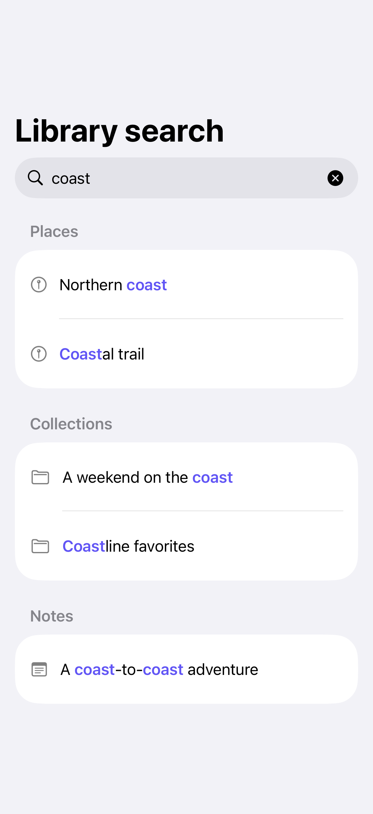

# Highlighted and grouped results

Grouping gives results context, while highlighted matches show why each item appeared.

## SwiftUI

```swift
import SwiftUI

struct HighlightedSearchResult: View {
    let title = "Northern coast"
    let query = "coast"

    var body: some View {
        Text(highlighted)
    }
    private var highlighted: AttributedString {
        var text = AttributedString(title)
        if let range = text.range(of: query, options: .caseInsensitive) {
            text[range].font = .body.bold()
            text[range].foregroundColor = .indigo
        }
        return text
    }
}
```

## Captures

<!-- captures:start -->
### iPhone 16 Pro · iOS 18.5

default. light appearance; Large text; en_US.



### iPhone 17 Pro · iOS 26.5

default. light appearance; Large text; en_US.


<!-- captures:end -->

## Full example

[Open the complete runnable example](SearchHighlightingGroupsDemo.swift).

## Reference

[Apple: AttributedString](https://developer.apple.com/documentation/swiftui/text).
