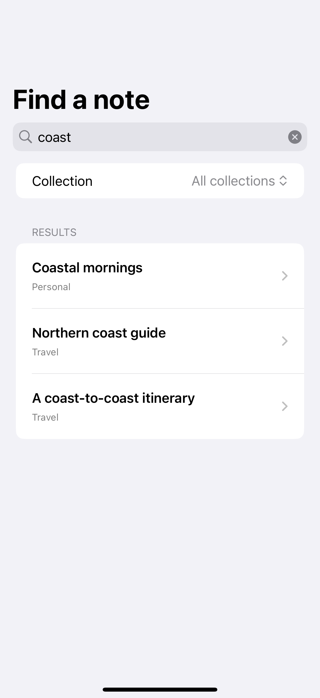
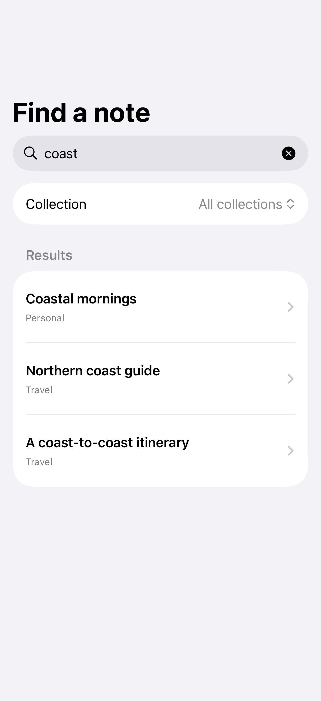
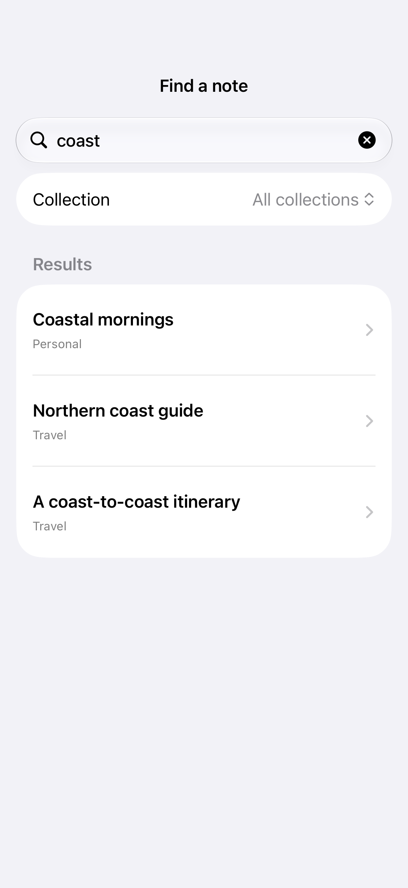

# Search state during navigation

Keeping the query in the search screen preserves its results when a detail destination closes.

## SwiftUI

```swift
import SwiftUI

struct PersistentSearchScreen: View {
    @State private var query = ""
    private let notes = ["Coastal mornings", "Garden notebook"]

    var body: some View {
        NavigationStack {
            List(notes.filter { query.isEmpty || $0.localizedCaseInsensitiveContains(query) }, id: \.self) { title in
                NavigationLink(title, value: title)
            }
            .searchable(text: $query)
            .navigationDestination(for: String.self) { Text($0) }
        }
    }
}
```

## Captures

<!-- captures:start -->
### iPhone 16 Pro · iOS 18.5

default. light appearance; Large text; en_US.



### iPhone 17 Pro · iOS 26.5

default. light appearance; Large text; en_US.



### iPhone 18 Pro · iOS 27.0

default. light appearance; Large text; en_US.


<!-- captures:end -->

## Full example

[Open the complete runnable example](SearchNavigationStateDemo.swift).

## Reference

[Apple: NavigationStack](https://developer.apple.com/documentation/swiftui/navigationstack).
