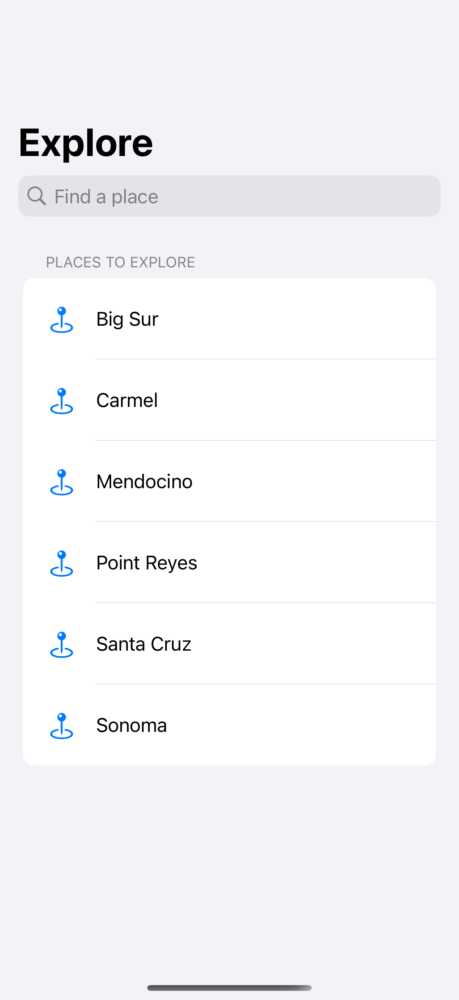
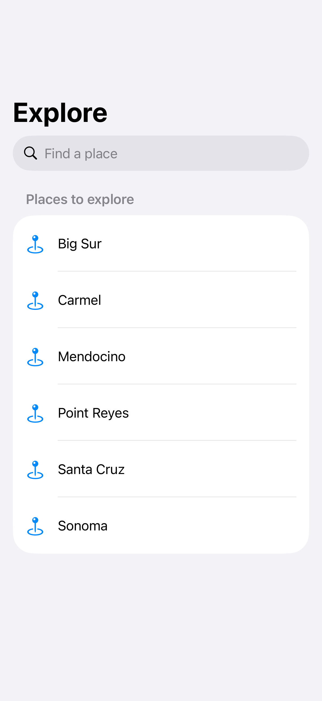
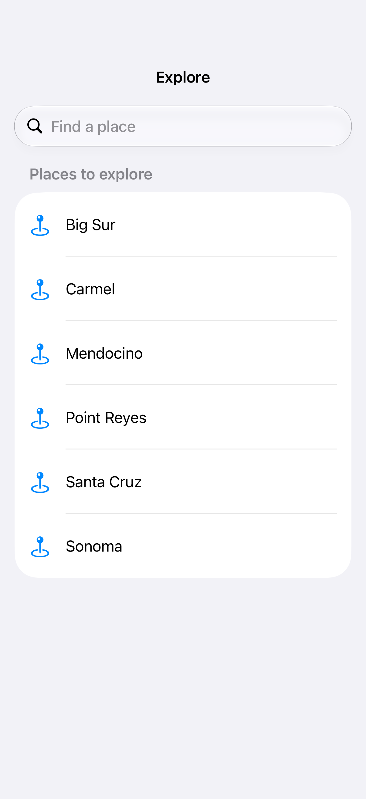

# Search placement and activation

A native search field can remain visible in the navigation bar and activate through a binding.

## SwiftUI

```swift
import SwiftUI

struct SearchablePlaces: View {
    @State private var query = ""
    @State private var presented = false

    var body: some View {
        NavigationStack {
            List(["Big Sur", "Carmel"].filter {
                query.isEmpty || $0.localizedCaseInsensitiveContains(query)
            }, id: \.self) { Text($0) }
            .navigationTitle("Explore")
            .searchable(text: $query, isPresented: $presented,
                        placement: .navigationBarDrawer(displayMode: .always))
        }
    }
}
```

## Captures

<!-- captures:start -->
### iPhone 16 Pro · iOS 18.5

default. light appearance; Large text; en_US.



### iPhone 17 Pro · iOS 26.5

default. light appearance; Large text; en_US.



### iPhone 18 Pro · iOS 27.0

default. light appearance; Large text; en_US.


<!-- captures:end -->

## Full example

[Open the complete runnable example](SearchPlacementActivationDemo.swift).

## Reference

[Apple: searchable](https://developer.apple.com/documentation/swiftui/view/searchable(text:placement:prompt:)).
