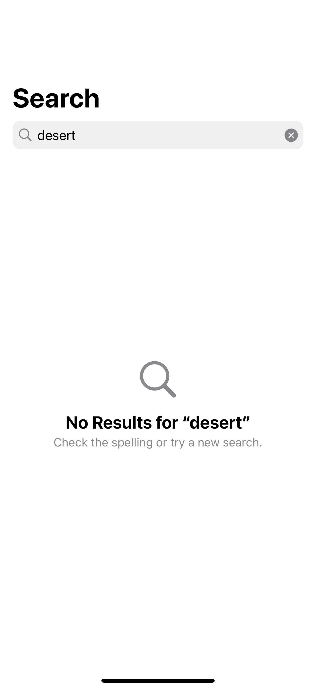
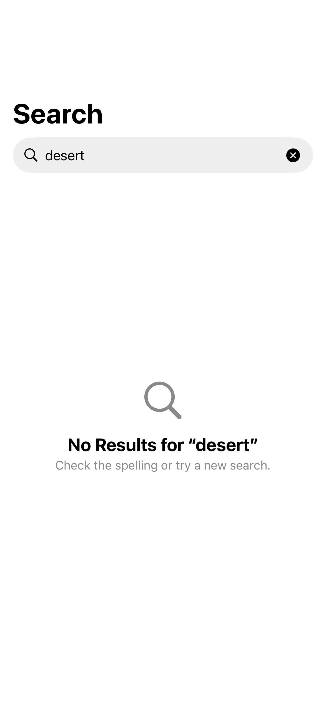

# Search result states

A search experience distinguishes an empty query, loading, no matches, and a recoverable error.

## SwiftUI

```swift
import SwiftUI

struct EmptySearchResults: View {
    @State private var query = ""
    private var results: [String] {
        ["Big Sur", "Carmel"].filter { query.isEmpty || $0.localizedCaseInsensitiveContains(query) }
    }

    var body: some View {
        NavigationStack {
            List(results, id: \.self) { Text($0) }
                .overlay {
                    if results.isEmpty { ContentUnavailableView.search(text: query) }
                }
                .searchable(text: $query)
        }
    }
}
```

## Captures

<!-- captures:start -->
### iPhone 16 Pro · iOS 18.5

default. light appearance; Large text; en_US.



### iPhone 17 Pro · iOS 26.5

default. light appearance; Large text; en_US.


<!-- captures:end -->

## Full example

[Open the complete runnable example](SearchResultStatesDemo.swift).

## Reference

[Apple: task(id:)](https://developer.apple.com/documentation/swiftui/contentunavailableview).
