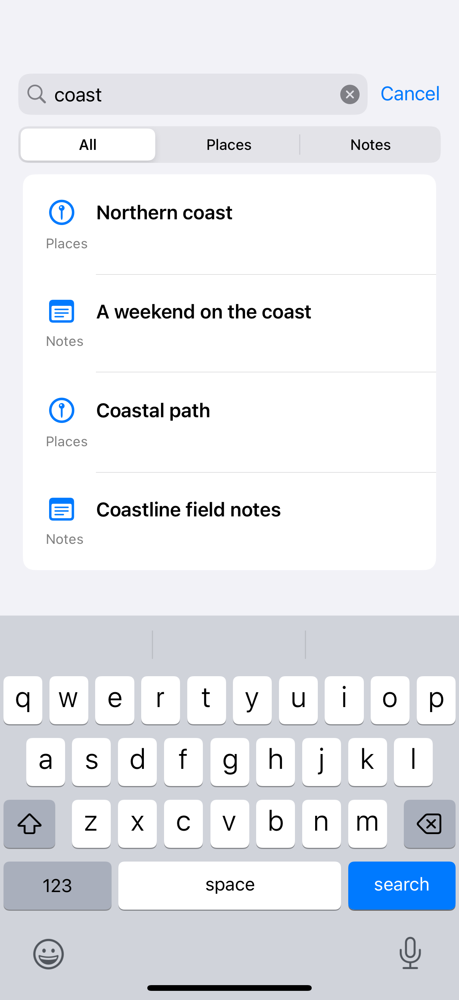

# Search scopes

Scopes narrow a query to a meaningful part of the same collection.

## SwiftUI

```swift
import SwiftUI

struct ScopedSearch: View {
    @State private var query = ""
    @State private var scope = "All"
    private let items = ["Places": ["Northern coast"], "Notes": ["Coastal field notes"]]

    var body: some View {
        NavigationStack {
            List {
                ForEach(items.keys.sorted().filter { scope == "All" || $0 == scope }, id: \.self) { category in
                    ForEach((items[category] ?? []).filter {
                        query.isEmpty || $0.localizedCaseInsensitiveContains(query)
                    }, id: \.self) { Text($0) }
                }
            }
            .searchable(text: $query)
            .searchScopes($scope) {
                Text("All").tag("All")
                Text("Places").tag("Places")
                Text("Notes").tag("Notes")
            }
        }
    }
}
```

## Captures

<!-- captures:start -->
### iPhone 16 Pro · iOS 18.5

default. light appearance; Large text; en_US.


<!-- captures:end -->

## Full example

[Open the complete runnable example](SearchScopesDemo.swift).

## Reference

[Apple: searchScopes](https://developer.apple.com/documentation/swiftui/view/searchscopes(_:scopes:)).
