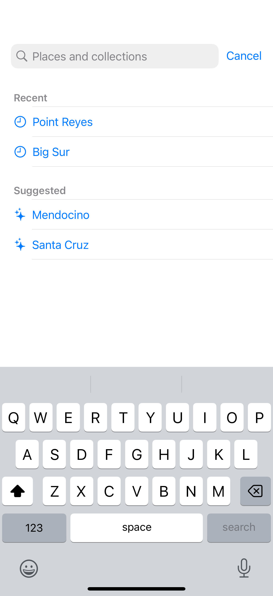

# Suggestions and recent searches

Native search suggestions offer useful completions before and during text entry.

## SwiftUI

```swift
import SwiftUI

struct SuggestedSearch: View {
    @State private var query = ""
    private let places = ["Big Sur", "Carmel", "Point Reyes"]

    var body: some View {
        NavigationStack {
            List(places.filter { query.isEmpty || $0.localizedCaseInsensitiveContains(query) }, id: \.self) { Text($0) }
                .searchable(text: $query)
                .searchSuggestions {
                    ForEach(places.filter { query.isEmpty || $0.localizedCaseInsensitiveContains(query) }, id: \.self) {
                        Text($0).searchCompletion($0)
                    }
                }
        }
    }
}
```

## Captures

<!-- captures:start -->
### iPhone 16 Pro · iOS 18.5

default. light appearance; Large text; en_US.


<!-- captures:end -->

## Full example

[Open the complete runnable example](SearchSuggestionsHistoryDemo.swift).

## Reference

[Apple: searchSuggestions](https://developer.apple.com/documentation/swiftui/view/searchsuggestions(_:)).
