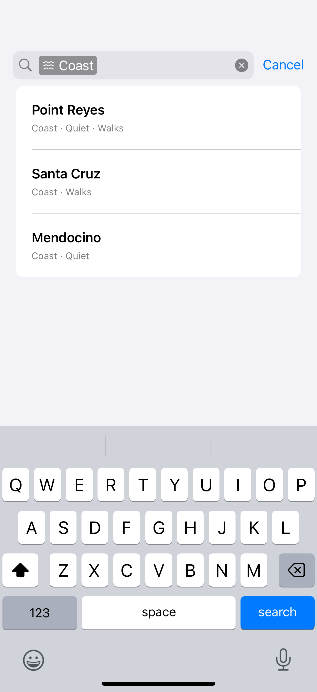

# Search tokens

Tokens turn structured constraints into removable items inside the native search field.

## SwiftUI

```swift
import SwiftUI

struct TokenSearch: View {
    struct Token: Identifiable { let id: String }
    @State private var query = ""
    @State private var tokens: [Token] = []
    @State private var suggestions = [Token(id: "Coast"), Token(id: "Quiet")]

    var body: some View {
        NavigationStack {
            Text(tokens.map(\.id).joined(separator: ", "))
                .searchable(text: $query, tokens: $tokens, suggestedTokens: $suggestions) {
                    Text($0.id)
                }
        }
    }
}
```

## Captures

<!-- captures:start -->
### iPhone 16 Pro · iOS 18.5

default. light appearance; Large text; en_US.


<!-- captures:end -->

## Full example

[Open the complete runnable example](SearchTokensDemo.swift).

## Reference

[Apple: searchable(tokens:)](https://developer.apple.com/documentation/swiftui/performing-a-search-operation).
