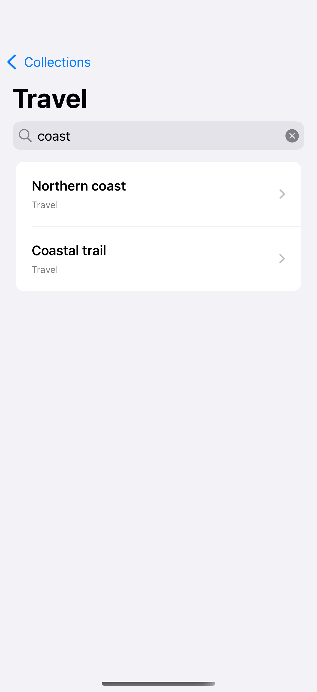
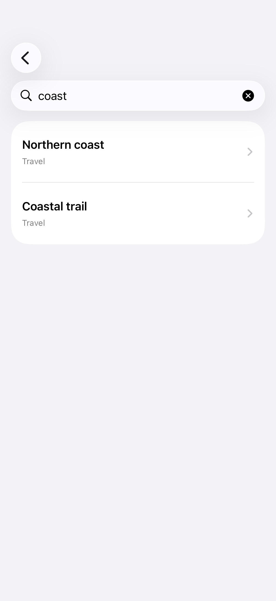

# Search in split views

A search field can filter the selected sidebar collection while leaving the larger navigation structure intact.

## SwiftUI

```swift
import SwiftUI

struct SearchableSplitView: View {
    @State private var collection: String? = "Travel"
    @State private var query = ""
    private let notes = ["Travel": ["Northern coast", "City weekends"], "Personal": ["Morning pages"]]

    var body: some View {
        NavigationSplitView {
            List(notes.keys.sorted(), id: \.self, selection: $collection) {
                NavigationLink($0, value: $0)
            }
        } detail: {
            List((notes[collection ?? ""] ?? []).filter {
                query.isEmpty || $0.localizedCaseInsensitiveContains(query)
            }, id: \.self) { Text($0) }
            .searchable(text: $query)
        }
    }
}
```

## Captures

<!-- captures:start -->
### iPhone 16 Pro · iOS 18.5

default. light appearance; Large text; en_US.



### iPhone 17 Pro · iOS 26.5

default. light appearance; Large text; en_US.


<!-- captures:end -->

## Full example

[Open the complete runnable example](SplitViewSearchDemo.swift).

## Reference

[Apple: NavigationSplitView](https://developer.apple.com/documentation/swiftui/navigationsplitview).
