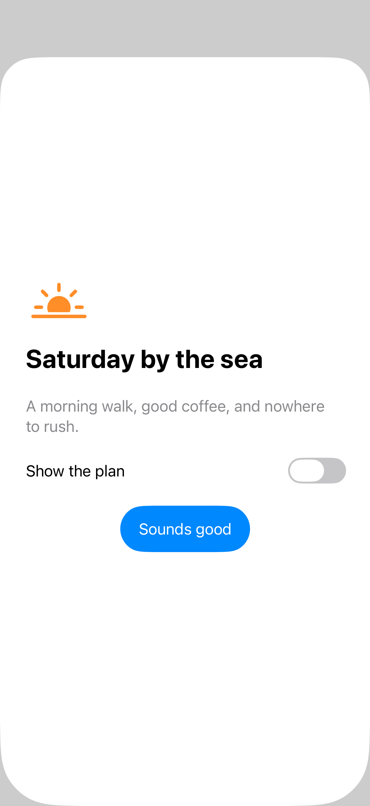
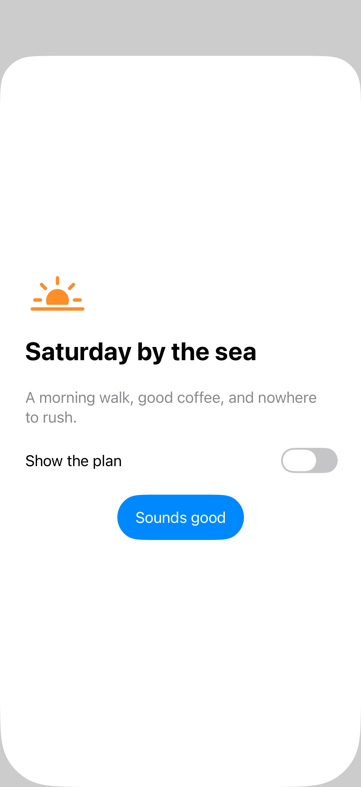
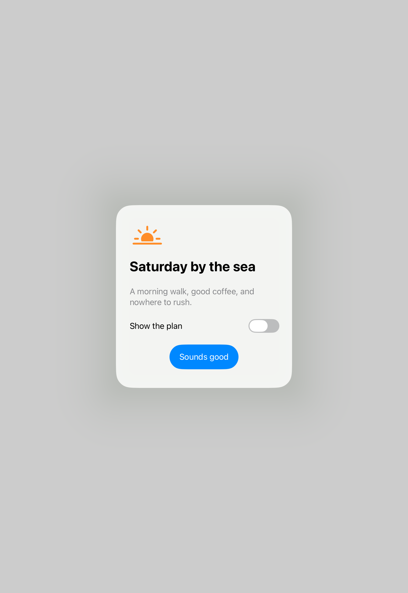
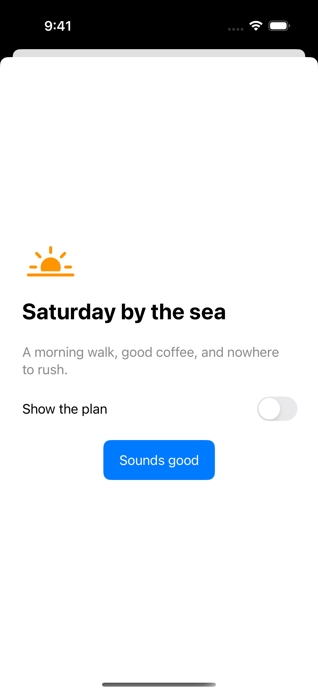

# Content-sized sheets

Fitted presentation sizing asks the system to size a sheet around its content. A stable width keeps the layout calm while added details change the preferred height; the final geometry still depends on the device and available space.

## SwiftUI

```swift
import SwiftUI

struct FittedSheetRecipe: View {
    @State private var isPresented = false
    @State private var showsDetails = false

    var body: some View {
        Button("Show invitation") { isPresented = true }
            .sheet(isPresented: $isPresented) {
                VStack(alignment: .leading, spacing: 20) {
                    Text("Saturday by the sea").font(.title2.bold())
                    Toggle("Show details", isOn: $showsDetails)
                    if showsDetails { Text("Meet at the harbor at 9:00 AM.") }
                }
                .padding(28)
                .frame(idealWidth: 360)
                .presentationSizing(.fitted.sticky(horizontal: true))
            }
    }
}
```

## Captures

<!-- captures:start -->
### iPhone 17 Pro · iOS 26.5

default. light appearance; Large text; en_US.



### iPhone 18 Pro · iOS 27.0

default. light appearance; Large text; en_US.



### iPad Pro 11-inch (M5) · iOS 27.0

Compact centered sheet shows complete content and controls; no clipping.. light appearance; Large text; en_US.



### iPhone 16 Pro · iOS 18.5

default. light appearance; Large text; en_US.


<!-- captures:end -->

## Full example

[Open the complete runnable example](ContentSizedSheetsDemo.swift).

## Reference

[Apple: sheets](https://developer.apple.com/design/human-interface-guidelines/sheets).
