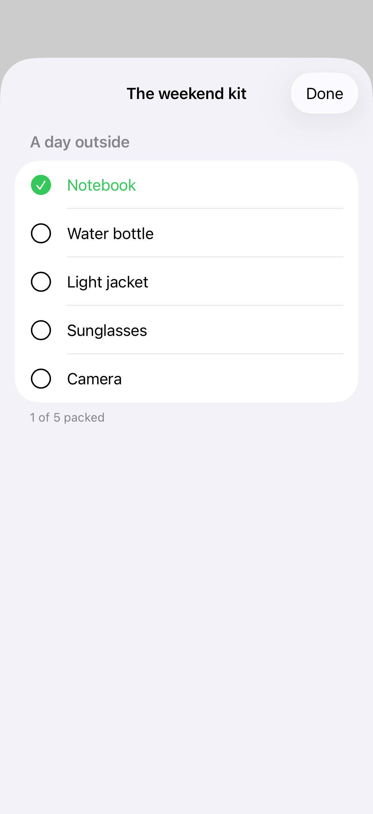
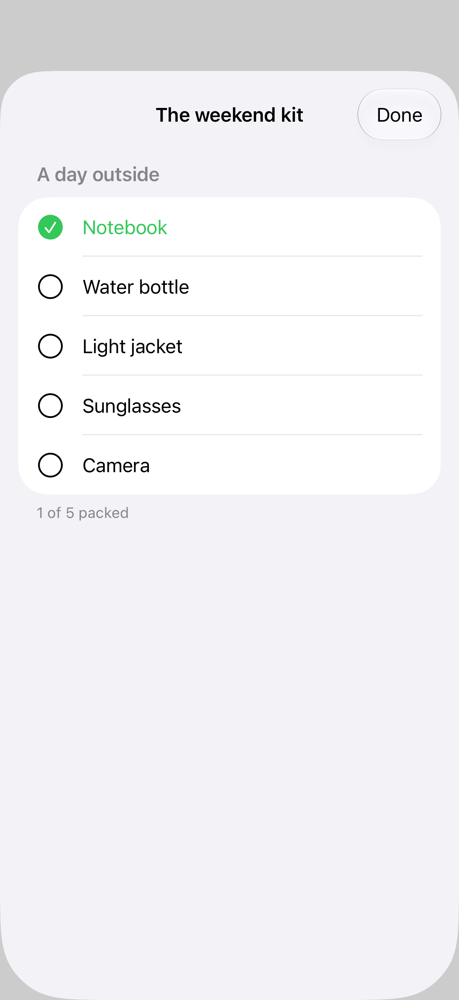
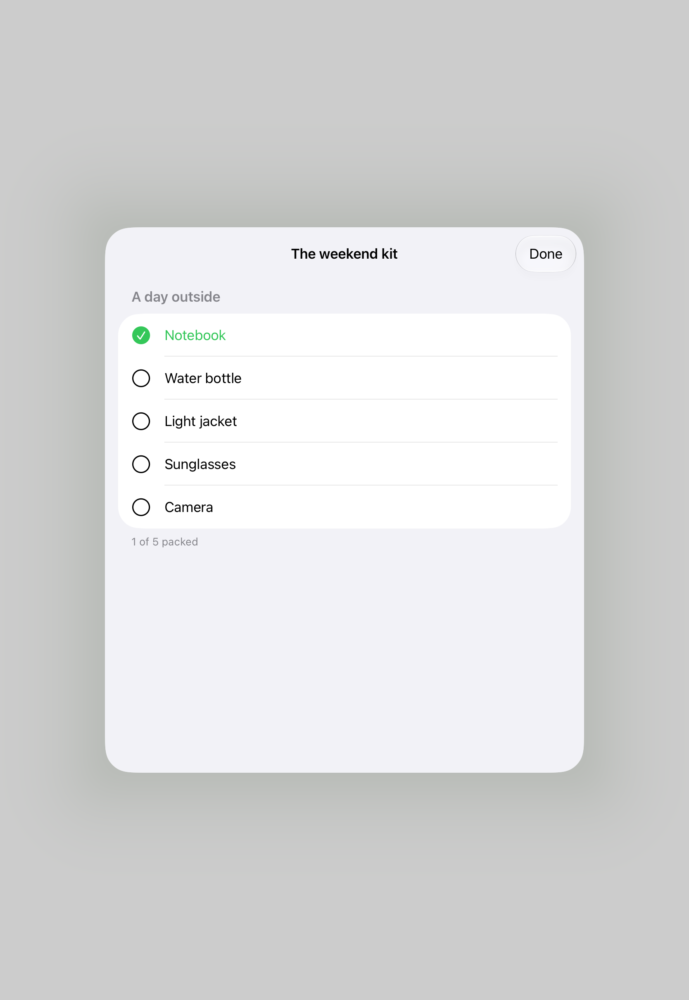
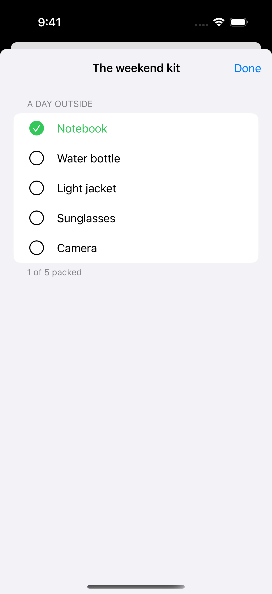

# Compact sheet adaptation

Sheets adapt as horizontal and vertical space changes. A compact adaptation preference lets you compare the system default with a sheet or full-screen treatment; rotate an iPhone or resize an iPad window to see where the policy takes effect.

## SwiftUI

```swift
import SwiftUI

struct SheetAdaptationRecipe: View {
    @State private var isPresented = false

    var body: some View {
        Button("Show packing list") { isPresented = true }
            .sheet(isPresented: $isPresented) {
                List(["Notebook", "Water bottle", "Light jacket"], id: \.self) {
                    Text($0)
                }
                .presentationSizing(.form)
                .presentationCompactAdaptation(.sheet)
            }
    }
}
```

## Captures

<!-- captures:start -->
### iPhone 17 Pro · iOS 26.5

default. light appearance; Large text; en_US.



### iPhone 18 Pro · iOS 27.0

default. light appearance; Large text; en_US.



### iPad Pro 11-inch (M5) · iOS 27.0

Centered native form presentation is visible and legible.. light appearance; Large text; en_US.



### iPhone 16 Pro · iOS 18.5

default. light appearance; Large text; en_US.


<!-- captures:end -->

## Full example

[Open the complete runnable example](SheetAdaptationDemo.swift).

## Reference

[Apple: sheets](https://developer.apple.com/design/human-interface-guidelines/sheets).
