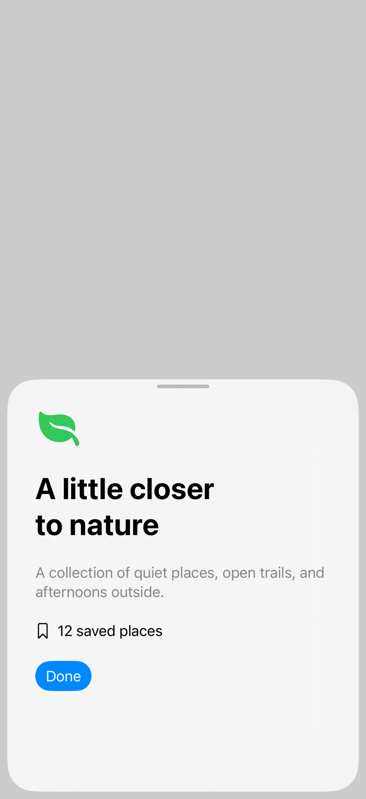
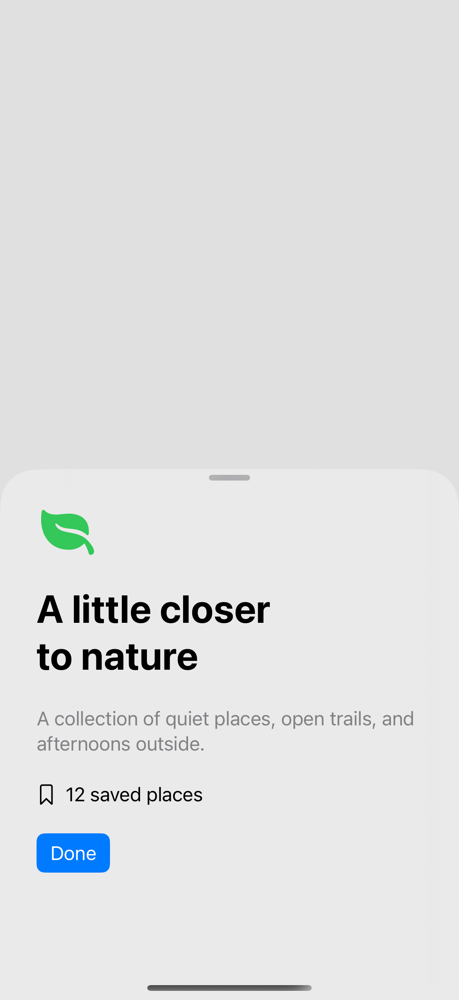

# Sheet appearance

A sheet keeps its native presentation behavior while you adjust its drag indicator, corner radius, and background. Materials, colors, and custom background views offer different levels of separation from the content underneath.

## SwiftUI

```swift
import SwiftUI

struct SheetAppearanceRecipe: View {
    @State private var isPresented = false

    var body: some View {
        Button("Show collection") { isPresented = true }
            .sheet(isPresented: $isPresented) {
                Text("Weekend references").font(.title2.bold()).padding(32)
                    .presentationDetents([.medium, .large])
                    .presentationDragIndicator(.visible)
                    .presentationCornerRadius(32)
                    .presentationBackground(.thinMaterial)
            }
    }
}
```

## Captures

<!-- captures:start -->
### iPhone 17 Pro · iOS 26.5

default. light appearance; Large text; en_US.


### iPhone 18 Pro · iOS 27.0

default. light appearance; Large text; en_US.



### iPhone 16 Pro · iOS 18.5

default. light appearance; Large text; en_US.


<!-- captures:end -->

## Full example

[Open the complete runnable example](SheetAppearanceDemo.swift).

## Reference

[Apple: sheets](https://developer.apple.com/design/human-interface-guidelines/sheets).
