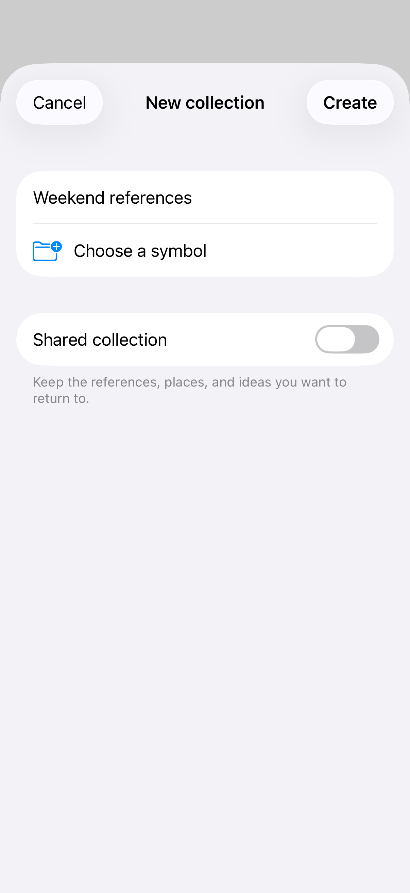
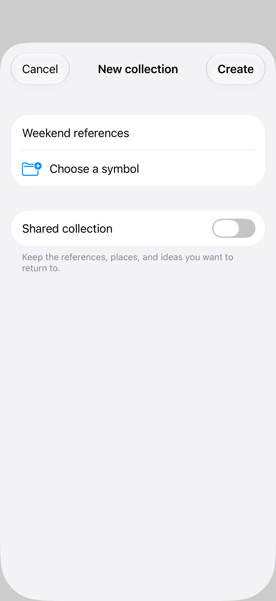
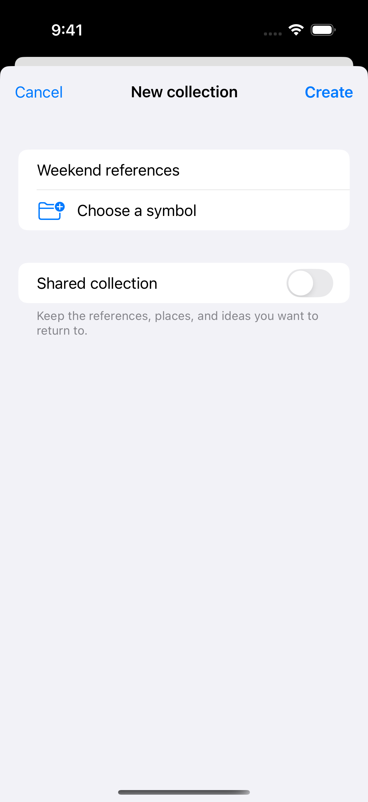

# Default sheets

A sheet presents a focused task above the current interface. Its default size and placement adapt to the available space; form and page sizing let you express the kind of content it contains.

## SwiftUI

```swift
import SwiftUI

struct DefaultSheetRecipe: View {
    @State private var isPresented = false

    var body: some View {
        Button("New collection") { isPresented = true }
            .sheet(isPresented: $isPresented) {
                NavigationStack {
                    Form {
                        Text("A place for your next idea.")
                    }
                    .navigationTitle("New collection")
                    .toolbar {
                        Button("Done") { isPresented = false }
                    }
                }
            }
    }
}
```

## Captures

<!-- captures:start -->
### iPhone 17 Pro · iOS 26.5

default. light appearance; Large text; en_US.



### iPhone 18 Pro · iOS 27.0

default. light appearance; Large text; en_US.



### iPhone 16 Pro · iOS 18.5

default. light appearance; Large text; en_US.


<!-- captures:end -->

## Full example

[Open the complete runnable example](SheetBasicsDemo.swift).

## Reference

[Apple: sheets](https://developer.apple.com/design/human-interface-guidelines/sheets).
