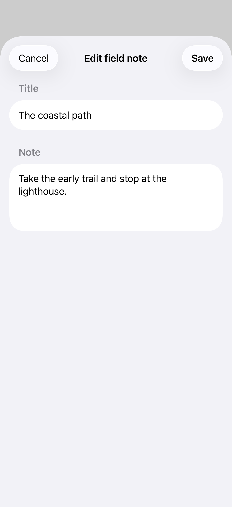
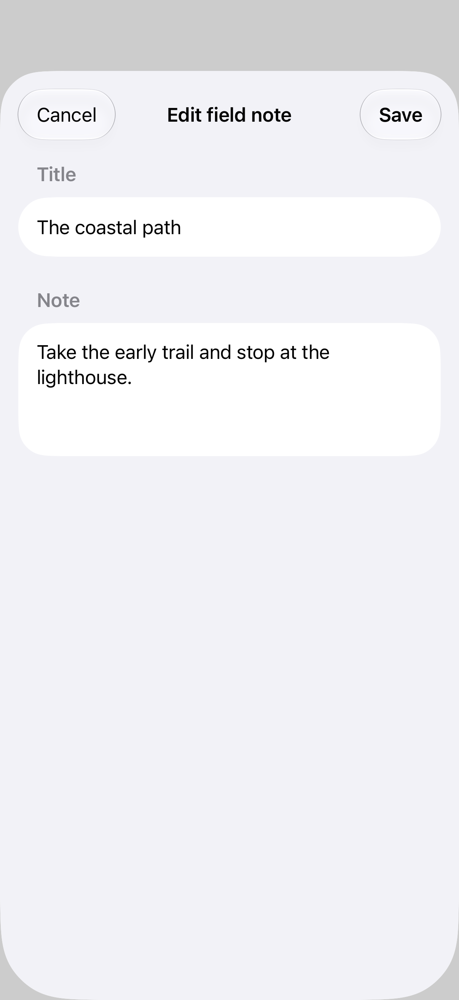

# Dismissal and unsaved changes

Interactive dismissal can be disabled while a sheet contains unsaved edits. An explicit Cancel action can then offer a discard confirmation, while Save commits the draft; the disabled swipe itself does not present a confirmation dialog.

## SwiftUI

```swift
import SwiftUI

struct SheetDismissalRecipe: View {
    @State private var isPresented = false
    @State private var saved = "Coastal path"
    @State private var draft = ""
    @State private var confirmDiscard = false

    var body: some View {
        Button("Edit note") { draft = saved; isPresented = true }
            .sheet(isPresented: $isPresented) {
                Form {
                    TextField("Title", text: $draft)
                    Button("Save") { saved = draft; isPresented = false }
                    Button("Cancel") {
                        if draft == saved { isPresented = false }
                        else { confirmDiscard = true }
                    }
                }
                .interactiveDismissDisabled(draft != saved)
                .confirmationDialog("Discard changes?", isPresented: $confirmDiscard) {
                    Button("Discard", role: .destructive) { isPresented = false }
                }
            }
    }
}
```

## Captures

<!-- captures:start -->
### iPhone 17 Pro · iOS 26.5

default. light appearance; Large text; en_US.



### iPhone 18 Pro · iOS 27.0

default. light appearance; Large text; en_US.


<!-- captures:end -->

## Full example

[Open the complete runnable example](SheetDismissalDemo.swift).

## Reference

[Apple: sheets](https://developer.apple.com/design/human-interface-guidelines/sheets).
