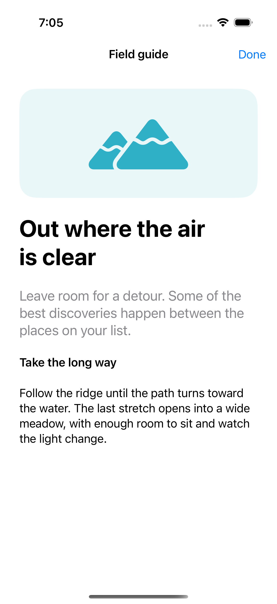
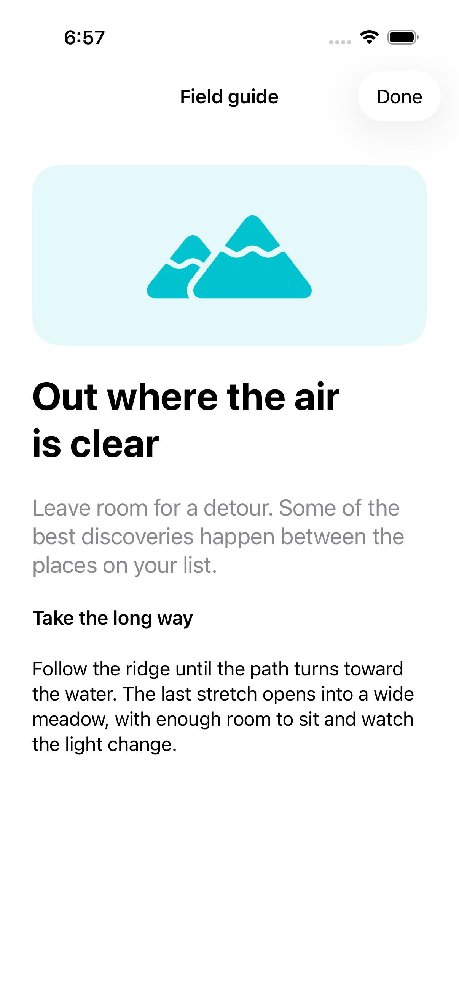
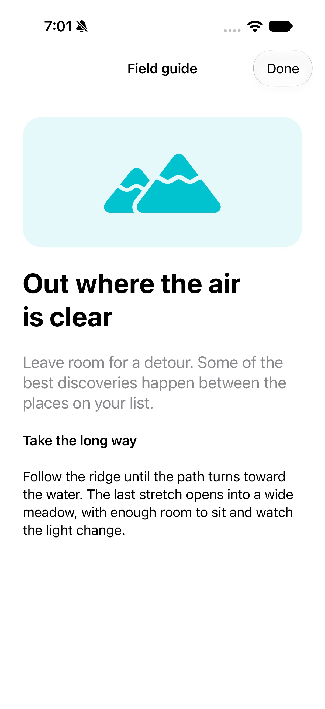

# From sheet to full screen

A full-screen cover presents a task across the available screen. To move from a sheet into that space, dismiss the sheet first and present the cover from its dismissal callback, giving the system one presentation transition at a time.

## SwiftUI

```swift
import SwiftUI

struct FullScreenHandoffRecipe: View {
    @State private var showsSheet = false
    @State private var showsCover = false
    @State private var expandsAfterDismissal = false

    var body: some View {
        Button("Preview") { showsSheet = true }
            .sheet(isPresented: $showsSheet, onDismiss: {
                if expandsAfterDismissal {
                    expandsAfterDismissal = false
                    showsCover = true
                }
            }) {
                Button("Open full screen") {
                    expandsAfterDismissal = true
                    showsSheet = false
                }
            }
            .fullScreenCover(isPresented: $showsCover) {
                Button("Done") { showsCover = false }
            }
    }
}
```

## Captures

<!-- captures:start -->
### iPhone 16 Pro · iOS 18.5

default. light appearance; Large text; en_US.



### iPhone 17 Pro · iOS 26.5

default. light appearance; Large text; en_US.



### iPhone 18 Pro · iOS 27.0

default. light appearance; Large text; en_US.


<!-- captures:end -->

## Full example

[Open the complete runnable example](SheetFullScreenDemo.swift).

## Reference

[Apple: sheets](https://developer.apple.com/design/human-interface-guidelines/sheets).
