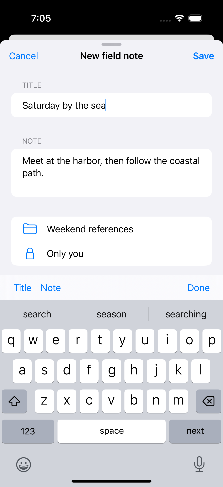
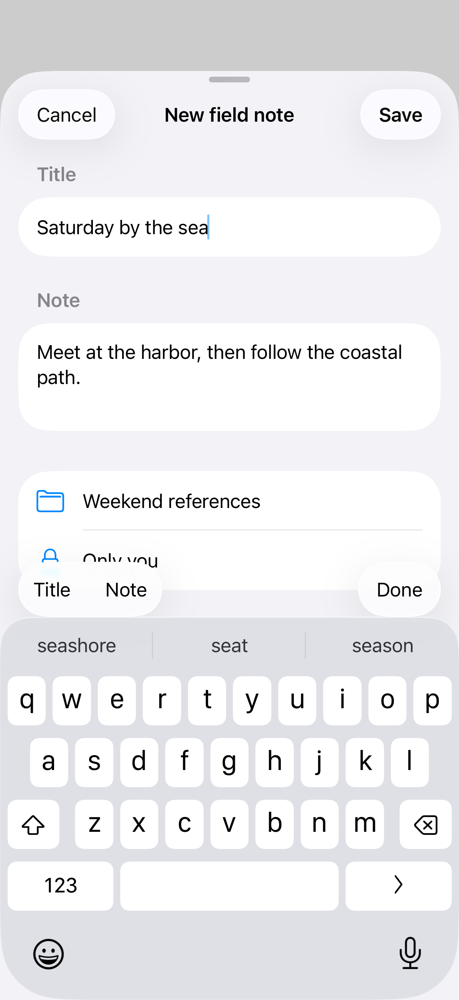
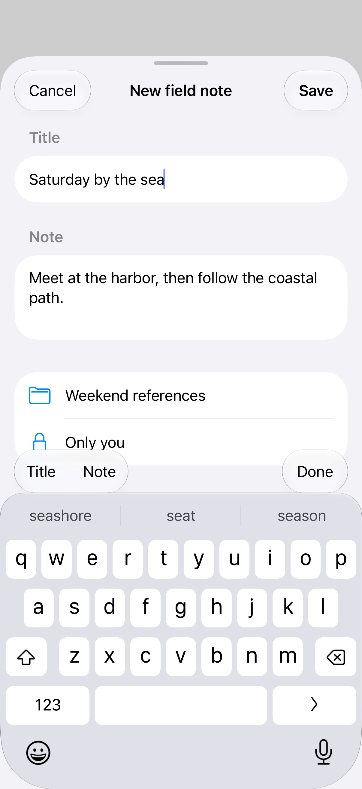

# Keyboards inside sheets

An editing sheet responds to keyboard focus and the space left above the keyboard. Focus state, submit actions, a keyboard toolbar, and interactive keyboard dismissal keep a short form easy to move through.

## SwiftUI

```swift
import SwiftUI

struct SheetKeyboardRecipe: View {
    @State private var isPresented = false
    @State private var title = ""
    @FocusState private var isFocused: Bool

    var body: some View {
        Button("New note") { isPresented = true }
            .sheet(isPresented: $isPresented) {
                Form {
                    TextField("Title", text: $title).focused($isFocused)
                }
                .scrollDismissesKeyboard(.interactively)
                .presentationDetents([.medium, .large])
                .task { isFocused = true }
            }
    }
}
```

## Captures

<!-- captures:start -->
### iPhone 16 Pro · iOS 18.5

default. light appearance; Large text; en_US.



### iPhone 17 Pro · iOS 26.5

default. light appearance; Large text; en_US.



### iPhone 18 Pro · iOS 27.0

default. light appearance; Large text; en_US.


<!-- captures:end -->

## Full example

[Open the complete runnable example](SheetKeyboardDemo.swift).

## Reference

[Apple: sheets](https://developer.apple.com/design/human-interface-guidelines/sheets).
