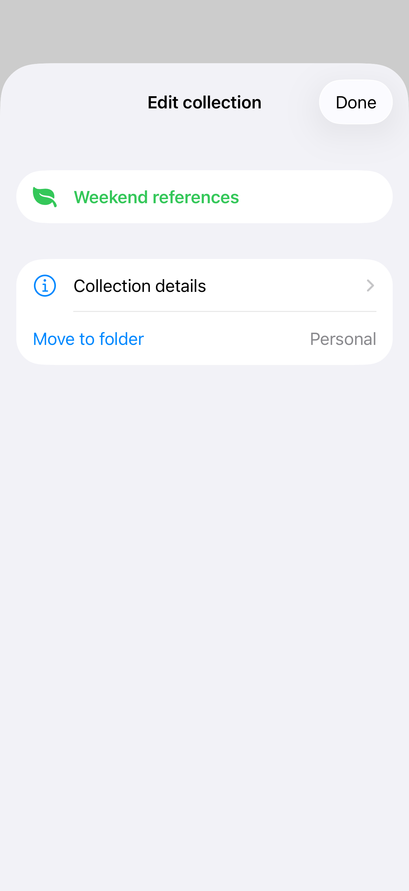
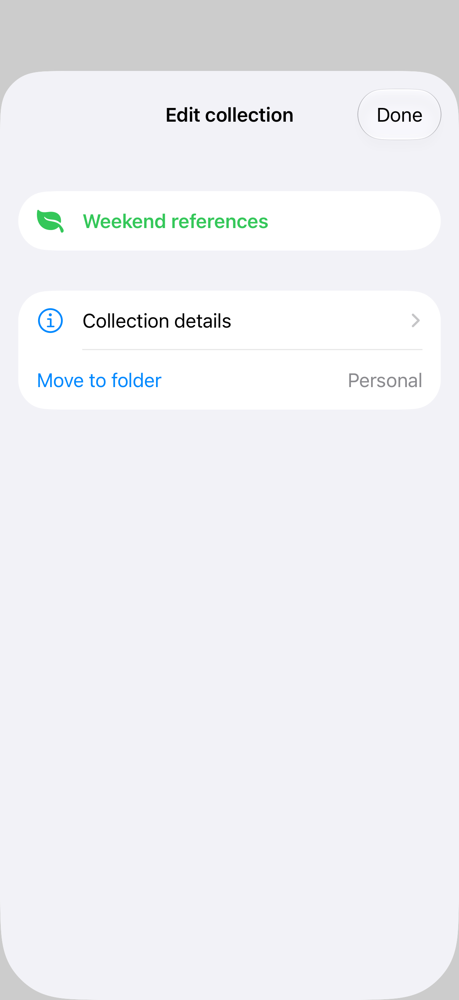
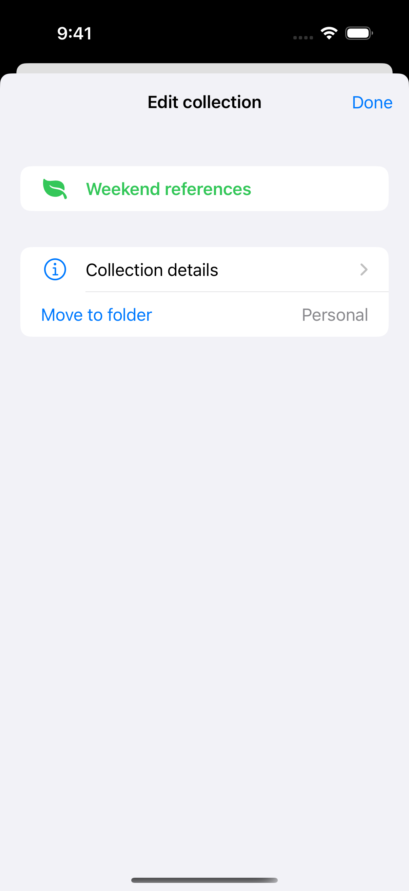

# Navigation and nested sheets

A navigation stack inside a sheet gives a modal task its own history and toolbar. A second sheet can present a supporting choice from that flow; attach it to the already-presented content so the first sheet remains underneath.

## SwiftUI

```swift
import SwiftUI

struct NestedSheetRecipe: View {
    @State private var isPresented = false

    var body: some View {
        Button("Edit collection") { isPresented = true }
            .sheet(isPresented: $isPresented) { CollectionEditorRecipe() }
    }
}

private struct CollectionEditorRecipe: View {
    @State private var choosesColor = false

    var body: some View {
        NavigationStack {
            List {
                NavigationLink("Details") { Text("Collection details") }
                Button("Choose color") { choosesColor = true }
            }
            .navigationTitle("Collection")
            .sheet(isPresented: $choosesColor) {
                Button("Use green") { choosesColor = false }
                    .presentationDetents([.medium])
            }
        }
    }
}
```

## Captures

<!-- captures:start -->
### iPhone 17 Pro · iOS 26.5

default. light appearance; Large text; en_US.



### iPhone 18 Pro · iOS 27.0

default. light appearance; Large text; en_US.



### iPhone 16 Pro · iOS 18.5

default. light appearance; Large text; en_US.


<!-- captures:end -->

## Full example

[Open the complete runnable example](SheetNavigationDemo.swift).

## Reference

[Apple: sheets](https://developer.apple.com/design/human-interface-guidelines/sheets).
