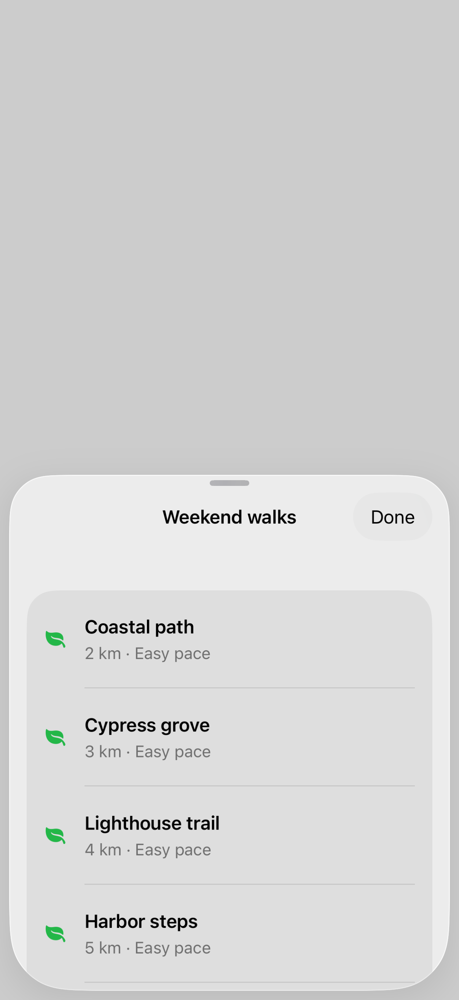
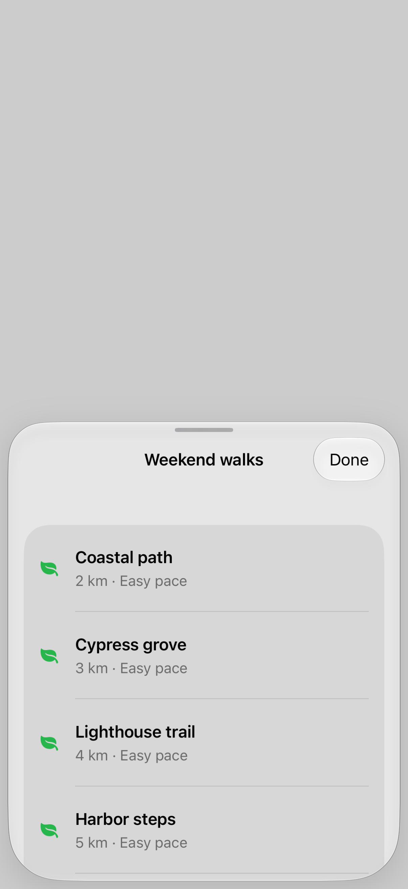

# Scrolling and resizing

A sheet containing scrollable content can use a gesture to resize the presentation or move through its content. Presentation content interaction lets you prefer scrolling immediately or expanding the sheet before scrolling.

## SwiftUI

```swift
import SwiftUI

struct SheetScrollingRecipe: View {
    @State private var isPresented = false

    var body: some View {
        Button("Show reading list") { isPresented = true }
            .sheet(isPresented: $isPresented) {
                List(1...30, id: \.self) { Text("Field note \($0)") }
                    .presentationDetents([.medium, .large])
                    .presentationContentInteraction(.scrolls)
            }
    }
}
```

## Captures

<!-- captures:start -->
### iPhone 17 Pro · iOS 26.5

default. light appearance; Large text; en_US.



### iPhone 18 Pro · iOS 27.0

default. light appearance; Large text; en_US.



### iPhone 16 Pro · iOS 18.5

default. light appearance; Large text; en_US.


<!-- captures:end -->

## Full example

[Open the complete runnable example](SheetScrollingDemo.swift).

## Reference

[Apple: sheets](https://developer.apple.com/design/human-interface-guidelines/sheets).
