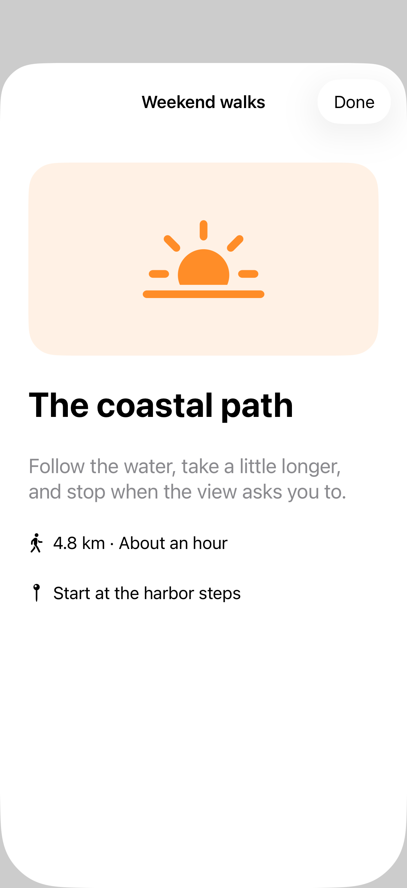
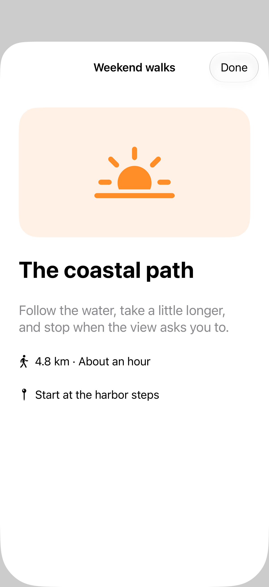

# Sheets from a source view

A zoom navigation transition connects a sheet to a visible source view. Matching the source identifier and namespace lets the system animate between the selected item and its presentation, including interactive dismissal.

## SwiftUI

```swift
import SwiftUI

struct SheetZoomRecipe: View {
    @Namespace private var transition
    @State private var isPresented = false

    var body: some View {
        Button("Coastal path") { isPresented = true }
            .matchedTransitionSource(id: "coast", in: transition)
            .sheet(isPresented: $isPresented) {
                Text("The coastal path").font(.largeTitle).padding()
                    .navigationTransition(.zoom(sourceID: "coast", in: transition))
            }
    }
}
```

## Captures

<!-- captures:start -->
### iPhone 17 Pro · iOS 26.5

default. light appearance; Large text; en_US.



### iPhone 18 Pro · iOS 27.0

default. light appearance; Large text; en_US.


<!-- captures:end -->

## Full example

[Open the complete runnable example](SheetSourceZoomDemo.swift).

## Reference

[Apple: sheets](https://developer.apple.com/design/human-interface-guidelines/sheets).
