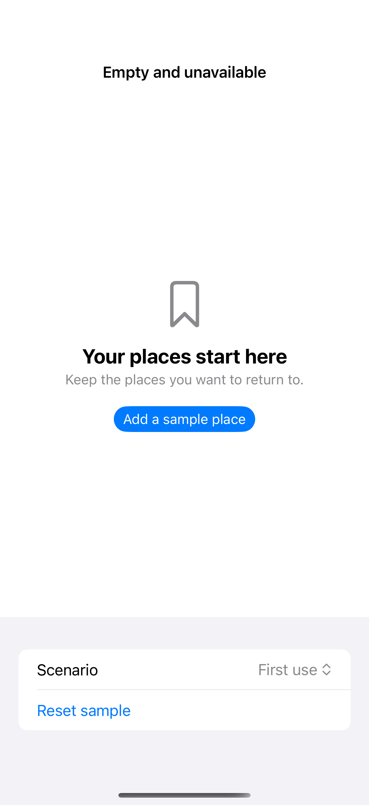

# Empty and unavailable content

ContentUnavailableView gives empty collections, first-use screens, missing search results, and unavailable content a consistent native structure. A short explanation and a relevant action should help someone create, find, or restore content instead of leaving a blank screen.

## SwiftUI

```swift
import SwiftUI

struct EmptyStateRecipe: View {
    @State private var places: [String] = []
    var body: some View {
        if places.isEmpty {
            ContentUnavailableView {
                Label("Your places start here", systemImage: "bookmark")
            } description: {
                Text("Keep the places you want to return to.")
            } actions: {
                Button("Add a sample place") { places.append("Harbor walk") }
                    .buttonStyle(.borderedProminent)
            }
        } else {
            List(places, id: \.self) { Text($0) }
        }
    }
}
```

## Captures

<!-- captures:start -->
### iPhone 16 Pro · iOS 18.5

default. light appearance; Large text; en_US.


<!-- captures:end -->

## Full example

[Open the complete runnable example](EmptyUnavailableDemo.swift).

## Reference

[Apple: loading](https://developer.apple.com/design/human-interface-guidelines/loading).
