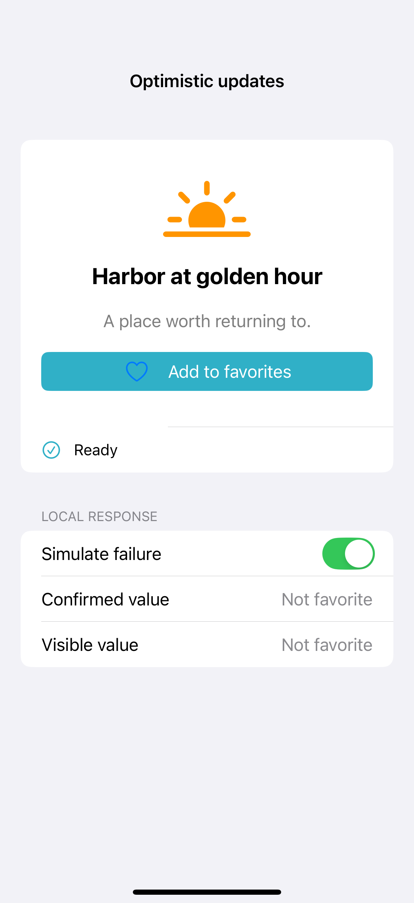

# Optimistic updates and rollback

An optimistic update changes the local interface immediately, then confirms or rolls back that change when work finishes. Keep the last confirmed value, prevent conflicting submissions, and make cancellation restore it too. A local failure switch makes both outcomes repeatable without a server.

## SwiftUI

```swift
import SwiftUI

struct OptimisticRecipe: View {
    @State private var favorite = false
    @State private var confirmed = false
    @State private var pending = false
    @State private var shouldFail = true
    var body: some View {
        VStack(spacing: 20) {
            Button(favorite ? "Remove favorite" : "Favorite") { favorite.toggle(); pending = true }
                .disabled(pending)
            Toggle("Simulate failure", isOn: $shouldFail).disabled(pending)
            if pending { ProgressView("Saving…") }
        }
        .task(id: pending) {
            guard pending else { return }
            do { try await Task.sleep(for: .seconds(1)) }
            catch { favorite = confirmed; pending = false; return }
            if shouldFail { favorite = confirmed } else { confirmed = favorite }
            pending = false
        }
    }
}
```

## Captures

<!-- captures:start -->
### iPhone 16 Pro · iOS 18.5

default. light appearance; Large text; en_US.


<!-- captures:end -->

## Full example

[Open the complete runnable example](OptimisticUpdatesDemo.swift).

## Reference

[Apple: loading](https://developer.apple.com/design/human-interface-guidelines/loading).
