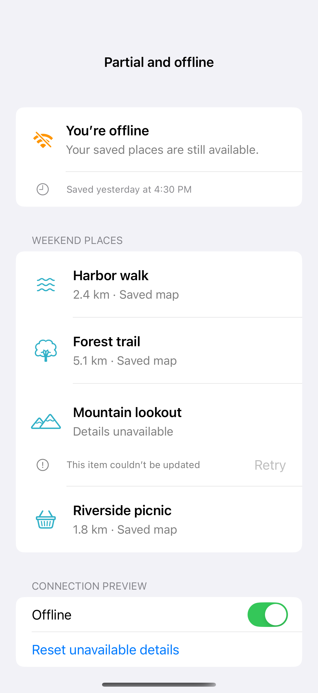

# Partial failures and offline content

A partial failure belongs beside the item that failed, while an offline indicator can explain why saved content is stale. Keep readable content available, disable only operations that require connectivity, and retry failed items independently. Connectivity and results here are controlled local fixtures.

## SwiftUI

```swift
import SwiftUI

struct OfflineRecipe: View {
    @State private var offline = true
    @State private var repaired = false
    var body: some View {
        List {
            if offline { Label("Offline · Showing saved places", systemImage: "wifi.slash") }
            Text("Harbor walk")
            Text("Forest trail")
            HStack {
                Label(repaired ? "Mountain lookout" : "Mountain details unavailable", systemImage: repaired ? "mountain.2" : "exclamationmark.circle")
                Spacer()
                if !repaired { Button("Retry") { repaired = true }.disabled(offline) }
            }
            Toggle("Offline", isOn: $offline)
        }
    }
}
```

## Captures

<!-- captures:start -->
### iPhone 16 Pro · iOS 18.5

default. light appearance; Large text; en_US.


<!-- captures:end -->

## Full example

[Open the complete runnable example](PartialOfflineDemo.swift).

## Reference

[Apple: loading](https://developer.apple.com/design/human-interface-guidelines/loading).
