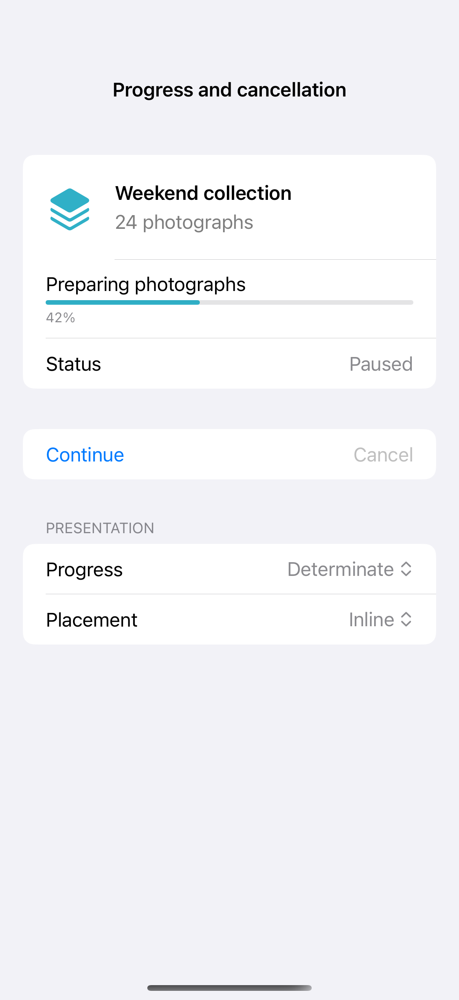

# Progress and cancellation

Progress views distinguish known completion from work with an unknown duration. Keep small tasks inline, reserve a larger loading surface for unavailable content, and cancel the underlying task when the user stops or leaves. This local simulation starts from a paused, deterministic progress value.

## SwiftUI

```swift
import SwiftUI

struct ProgressRecipe: View {
    @State private var progress = 0.0
    @State private var task: Task<Void, Never>?
    var body: some View {
        VStack(spacing: 20) {
            ProgressView("Preparing collection", value: progress)
            Button("Start") {
                task?.cancel()
                progress = 0
                task = Task {
                    for step in 1...10 {
                        do { try await Task.sleep(for: .milliseconds(200)) } catch { return }
                        progress = Double(step) / 10
                    }
                    task = nil
                }
            }.disabled(task != nil)
            Button("Cancel") { task?.cancel(); task = nil }.disabled(task == nil)
        }.padding().onDisappear { task?.cancel(); task = nil }
    }
}
```

## Captures

<!-- captures:start -->
### iPhone 16 Pro · iOS 18.5

default. light appearance; Large text; en_US.


<!-- captures:end -->

## Full example

[Open the complete runnable example](ProgressCancellationDemo.swift).

## Reference

[Apple: loading](https://developer.apple.com/design/human-interface-guidelines/loading).
