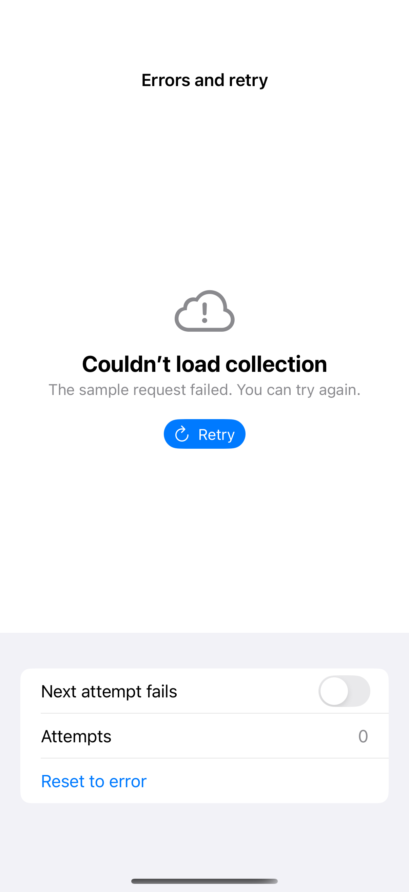

# Recoverable errors and retry

A recoverable error explains what failed, preserves a clear retry action, and prevents duplicate work while retrying. This deterministic local state machine can succeed or fail after a short delay, and cancellation returns to an actionable state without delivering a late result.

## SwiftUI

```swift
import SwiftUI

struct RetryRecipe: View {
    @State private var loaded = false
    @State private var retrying = false
    var body: some View {
        Group {
            if loaded { Text("Collection ready") }
            else {
                ContentUnavailableView {
                    Label("Couldn’t load collection", systemImage: "exclamationmark.icloud")
                } actions: {
                    Button(retrying ? "Retrying…" : "Retry") { retrying = true }.disabled(retrying)
                }
            }
        }
        .task(id: retrying) {
            guard retrying else { return }
            do { try await Task.sleep(for: .seconds(1)) } catch { return }
            loaded = true; retrying = false
        }
    }
}
```

## Captures

<!-- captures:start -->
### iPhone 16 Pro · iOS 18.5

default. light appearance; Large text; en_US.


<!-- captures:end -->

## Full example

[Open the complete runnable example](RecoverableErrorsDemo.swift).

## Reference

[Apple: loading](https://developer.apple.com/design/human-interface-guidelines/loading).
