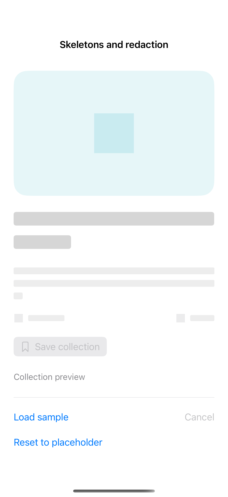

# Skeletons and redaction

Redaction turns a representative content shape into a native placeholder without changing its layout. Hide placeholder data from accessibility and disable its actions, then replace it in place when the local task completes; cancellation keeps the preview ready for another attempt.

## SwiftUI

```swift
import SwiftUI

struct SkeletonRecipe: View {
    @State private var loaded = false
    var body: some View {
        VStack(alignment: .leading, spacing: 16) {
            VStack(alignment: .leading, spacing: 8) {
                Text("A weekend in the mountains").font(.title2.bold())
                Text("Three trails, a small cabin, and a slower pace.")
            }
            .redacted(reason: loaded ? [] : .placeholder)
            .accessibilityHidden(!loaded)
            if !loaded { Text("Collection preview").font(.caption).foregroundStyle(.secondary) }
            Button(loaded ? "Show placeholder" : "Reveal content") { loaded.toggle() }
        }.padding()
    }
}
```

## Captures

<!-- captures:start -->
### iPhone 16 Pro · iOS 18.5

default. light appearance; Large text; en_US.


<!-- captures:end -->

## Full example

[Open the complete runnable example](SkeletonRedactionDemo.swift).

## Reference

[Apple: loading](https://developer.apple.com/design/human-interface-guidelines/loading).
