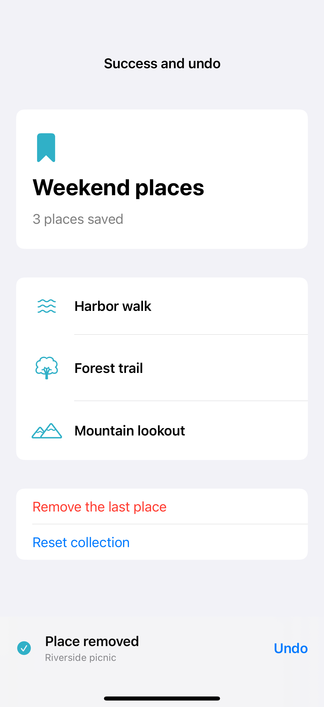

# Success confirmation and undo

A visible confirmation can acknowledge a completed change and keep Undo within reach. This local collection stores the last removed item and its original position, so Undo restores that item without rebuilding the list; the capture shows a real sample removal with its undo action available.

## SwiftUI

```swift
import SwiftUI

struct UndoRecipe: View {
    @State private var items = ["Harbor", "Forest", "Mountain"]
    @State private var removed: (name: String, index: Int)?
    var body: some View {
        List {
            ForEach(items, id: \.self) { name in
                Text(name).swipeActions {
                    Button("Remove", role: .destructive) {
                        guard let index = items.firstIndex(of: name) else { return }
                        removed = (name, index); items.remove(at: index)
                    }
                }
            }
        }
        .safeAreaInset(edge: .bottom) {
            if let previous = removed {
                HStack {
                    Text("Place removed")
                    Spacer()
                    Button("Undo") {
                        items.insert(previous.name, at: min(previous.index, items.count)); removed = nil
                    }
                }.padding().background(.regularMaterial)
            }
        }
    }
}
```

## Captures

<!-- captures:start -->
### iPhone 16 Pro · iOS 18.5

default. light appearance; Large text; en_US.


<!-- captures:end -->

## Full example

[Open the complete runnable example](SuccessUndoDemo.swift).

## Reference

[Apple: loading](https://developer.apple.com/design/human-interface-guidelines/loading).
