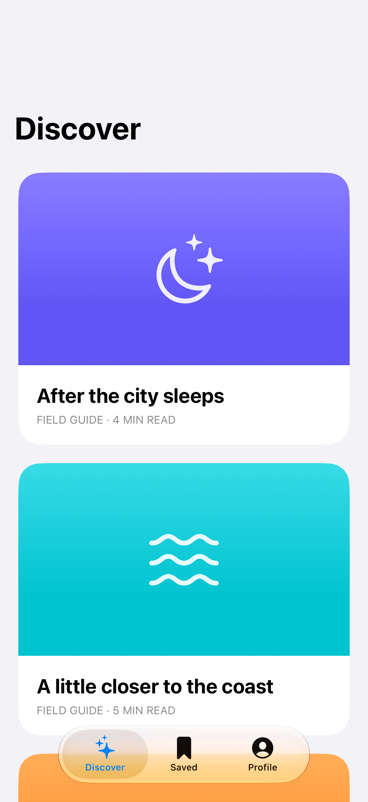
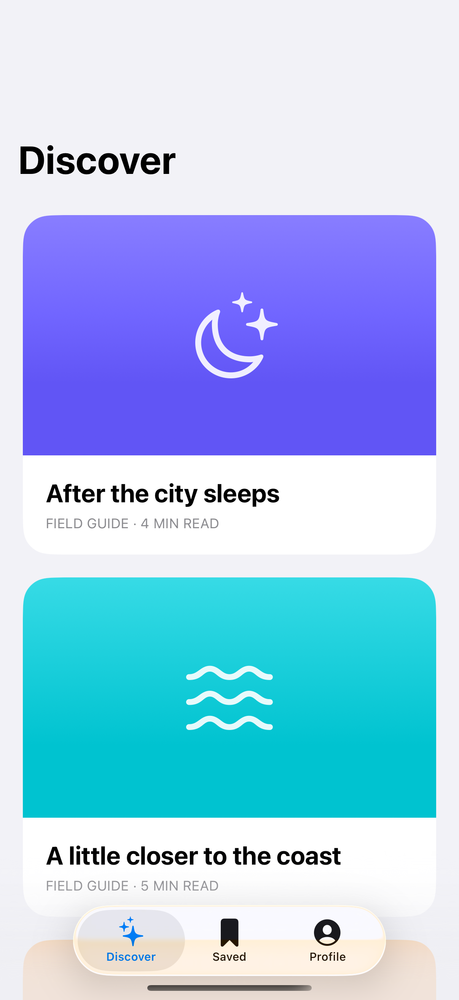

# Minimizing tab bars

A tab bar can become compact as content scrolls and expand when the user returns.

## SwiftUI

```swift
import SwiftUI

@available(iOS 26.0, *)
struct MinimizingTabs: View {
    var body: some View {
        TabView {
            Tab("Discover", systemImage: "sparkles") {
                NavigationStack {
                    List(1...50, id: \.self) { Text("Story \($0)") }
                        .navigationTitle("Discover")
                }
            }
            Tab("Saved", systemImage: "bookmark") {
                Text("Saved stories")
            }
        }
        .tabBarMinimizeBehavior(.onScrollDown)
    }
}
```

## Captures

<!-- captures:start -->
### iPhone 18 Pro · iOS 27.0

default. light appearance; Large text; en_US.



### iPhone 17 Pro · iOS 26.5

default. light appearance; Large text; en_US.


<!-- captures:end -->

## Full example

[Open the complete runnable example](MinimizingTabBarsDemo.swift).

## Reference

[Apple: tabBarMinimizeBehavior](https://developer.apple.com/documentation/swiftui/view/tabbarminimizebehavior(_:)).
