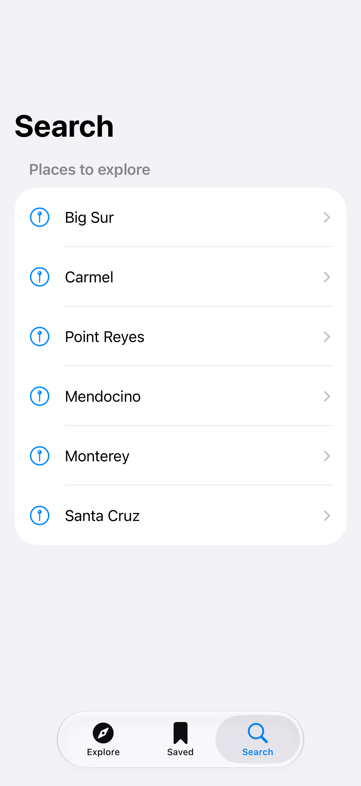
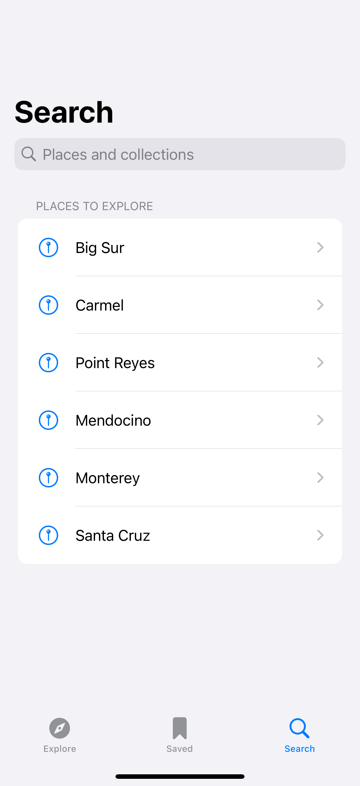
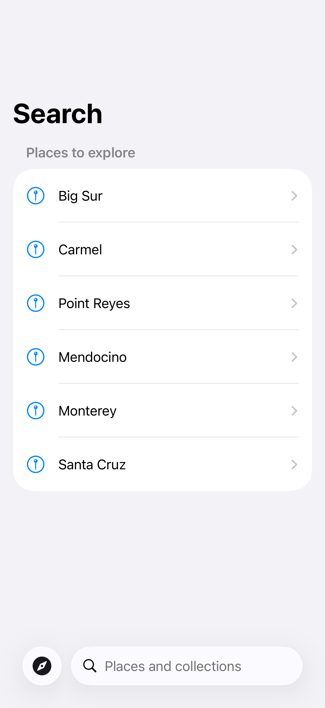

# Search tabs

A dedicated search tab gives discovery its own place in the tab bar.

## SwiftUI

```swift
import SwiftUI

struct SearchTabs: View {
    @State private var query = ""

    var body: some View {
        TabView {
            Tab("Explore", systemImage: "safari") {
                Text("Explore")
            }
            Tab("Search", systemImage: "magnifyingglass", role: .search) {
                NavigationStack {
                    List(["Big Sur", "Carmel"].filter {
                        query.isEmpty || $0.localizedCaseInsensitiveContains(query)
                    }, id: \.self) { Text($0) }
                    .navigationTitle("Search")
                }
                .searchable(text: $query)
            }
        }
    }
}
```

## Captures

<!-- captures:start -->
### iPhone 18 Pro · iOS 27.0

default. light appearance; Large text; en_US.



### iPhone 16 Pro · iOS 18.5

default. light appearance; Large text; en_US.



### iPhone 17 Pro · iOS 26.5

default. light appearance; Large text; en_US.


<!-- captures:end -->

## Full example

[Open the complete runnable example](SearchTabDemo.swift).

## Reference

[Apple: TabRole.search](https://developer.apple.com/documentation/swiftui/tabrole/search).
