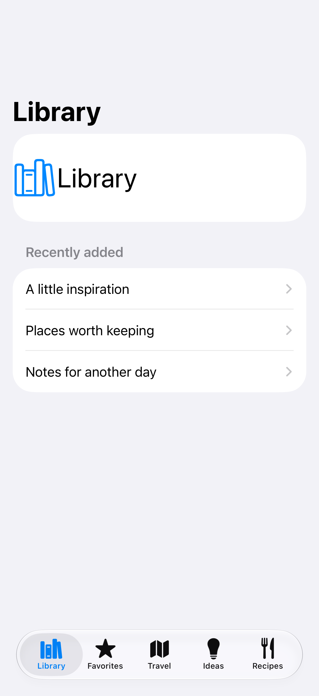
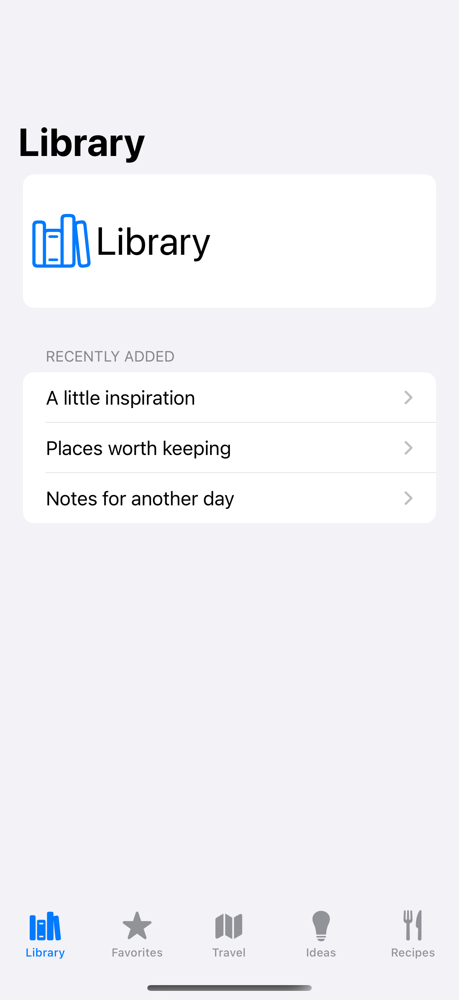
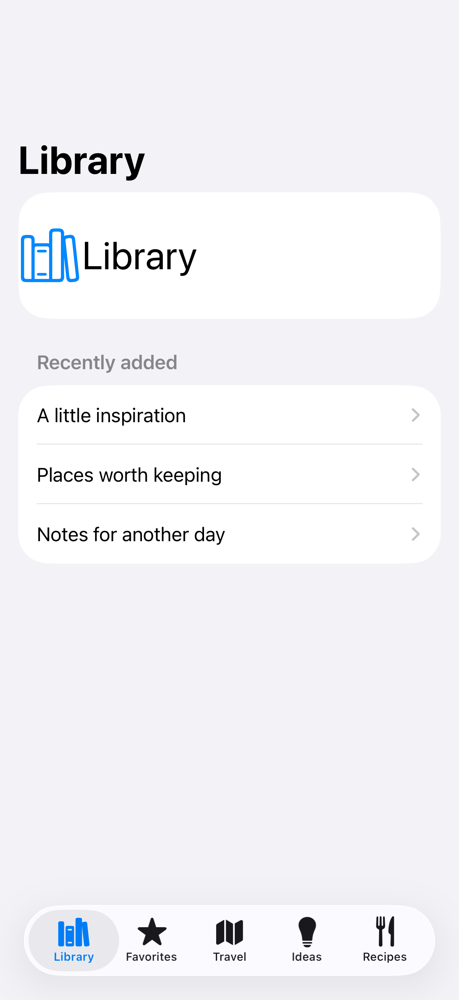
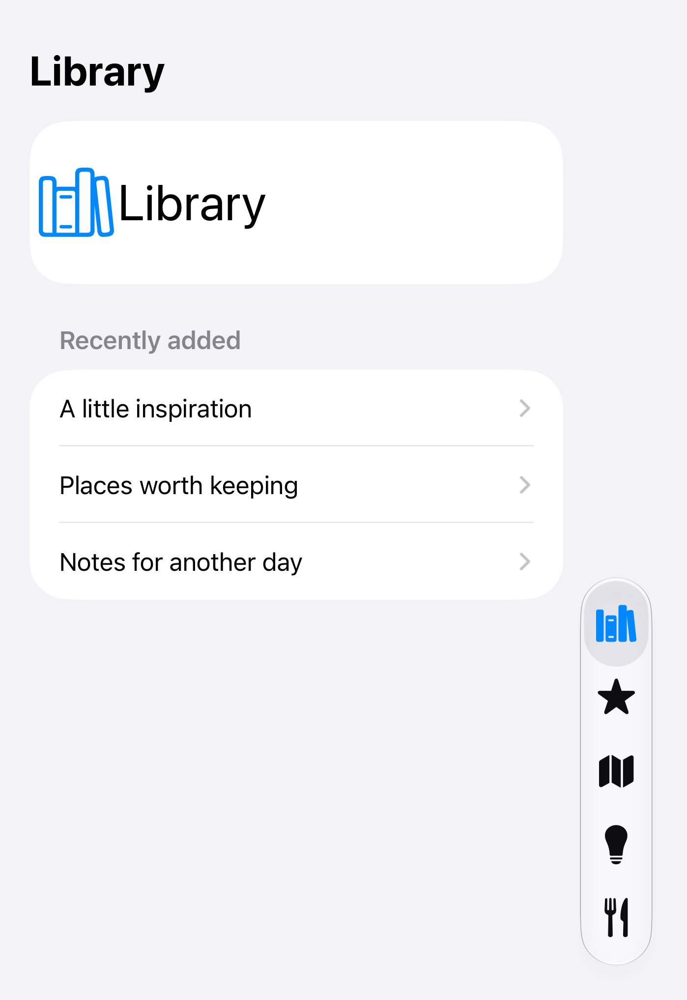

# Tabs that become a sidebar

A sidebar-adaptable tab view organizes the same sections for compact and wide layouts.

## SwiftUI

```swift
import SwiftUI

struct AdaptableTabs: View {
    @AppStorage("tabCustomization") private var customization = TabViewCustomization()

    var body: some View {
        TabView {
            Tab("Library", systemImage: "books.vertical") { Text("Library") }
                .customizationID("library")
            TabSection("Collections") {
                Tab("Travel", systemImage: "map") { Text("Travel") }
                    .customizationID("travel")
                Tab("Ideas", systemImage: "lightbulb") { Text("Ideas") }
                    .customizationID("ideas")
            }
        }
        .tabViewStyle(.sidebarAdaptable)
        .tabViewCustomization($customization)
    }
}
```

## Captures

<!-- captures:start -->
### iPhone 18 Pro · iOS 27.0

default. light appearance; Large text; en_US.



### iPhone 16 Pro · iOS 18.5

default. light appearance; Large text; en_US.



### iPhone 17 Pro · iOS 26.5

default. light appearance; Large text; en_US.



### iPhone Duo · iOS 27.1

default. light appearance; Large text; en_US.


<!-- captures:end -->

## Full example

[Open the complete runnable example](SidebarAdaptableTabsDemo.swift).

## Reference

[Apple: sidebarAdaptable](https://developer.apple.com/documentation/swiftui/sidebaradaptabletabviewstyle).
