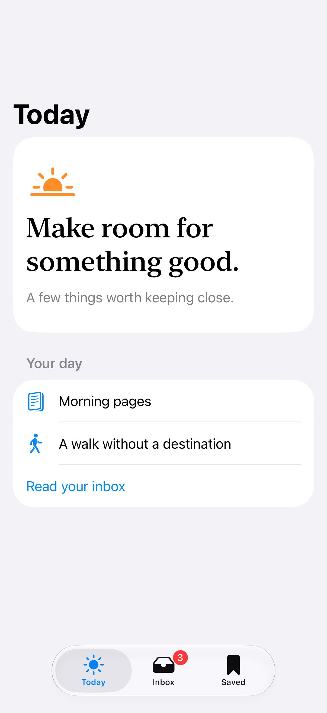
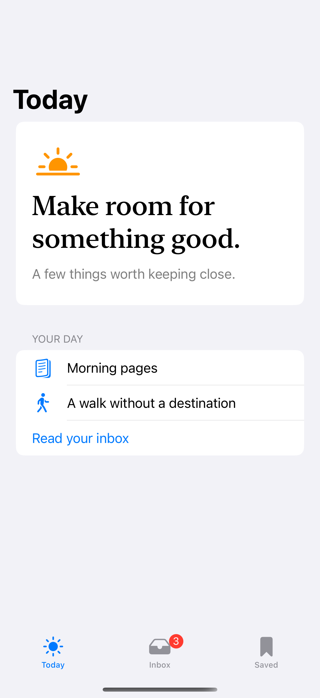

# Standard tabs

A tab bar switches between the main sections of an app.

## SwiftUI

```swift
import SwiftUI

struct AppTabs: View {
    @State private var selection = 0

    var body: some View {
        TabView(selection: $selection) {
            Tab("Today", systemImage: "sun.max", value: 0) {
                Text("Today")
            }
            Tab("Inbox", systemImage: "tray", value: 1) {
                Text("Inbox")
            }
            .badge(3)
            Tab("Saved", systemImage: "bookmark", value: 2) {
                Text("Saved")
            }
        }
    }
}
```

## Captures

<!-- captures:start -->
### iPhone 18 Pro · iOS 27.0

default. light appearance; Large text; en_US.



### iPhone 16 Pro · iOS 18.5

default. light appearance; Large text; en_US.



### iPhone 17 Pro · iOS 26.5

default. light appearance; Large text; en_US.


<!-- captures:end -->

## Full example

[Open the complete runnable example](StandardTabsDemo.swift).

## Reference

[Apple: TabView](https://developer.apple.com/documentation/swiftui/tabview).
