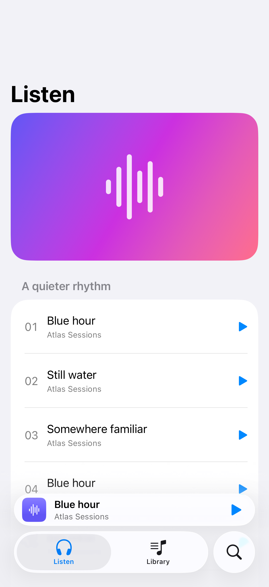

# Tab bottom accessories

A bottom accessory keeps a compact task, such as playback, close to the tab bar.

## SwiftUI

```swift
import SwiftUI

@available(iOS 26.0, *)
struct AccessoryTabs: View {
    @State private var playing = false

    var body: some View {
        TabView {
            Tab("Listen", systemImage: "headphones") {
                List(1...30, id: \.self) { Text("Track \($0)") }
            }
            Tab("Library", systemImage: "music.note.list") { Text("Library") }
        }
        .tabBarMinimizeBehavior(.onScrollDown)
        .tabViewBottomAccessory {
            HStack {
                Text("Blue hour").frame(maxWidth: .infinity, alignment: .leading)
                Button(playing ? "Pause" : "Play",
                       systemImage: playing ? "pause.fill" : "play.fill") {
                    playing.toggle()
                }
                .labelStyle(.iconOnly)
            }
            .padding(.horizontal)
        }
    }
}
```

## Captures

<!-- captures:start -->
### iPhone 17 Pro · iOS 26.5

default. light appearance; Large text; en_US.


<!-- captures:end -->

## Full example

[Open the complete runnable example](TabBottomAccessoryDemo.swift).

## Reference

[Apple: tabViewBottomAccessory](https://developer.apple.com/documentation/swiftui/view/tabviewbottomaccessory(content:)).
