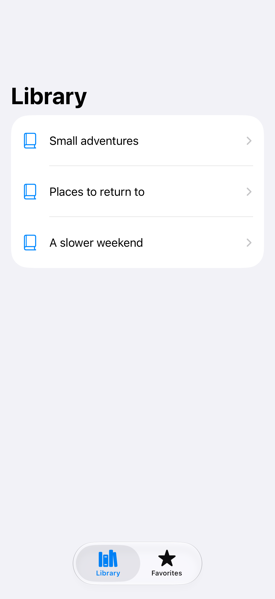
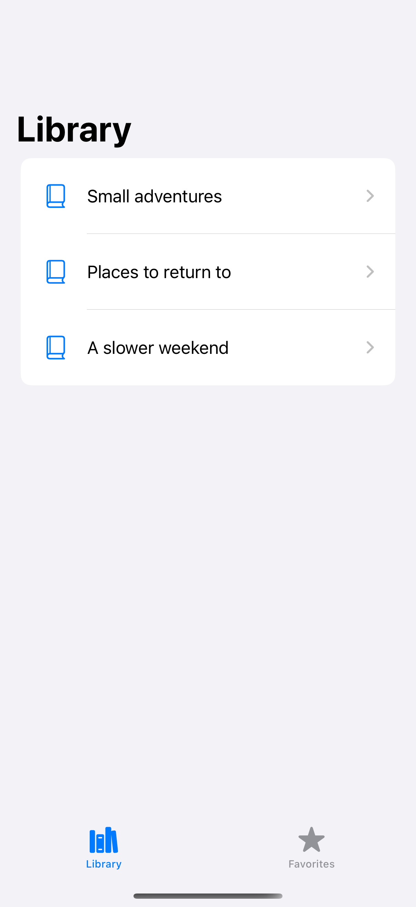
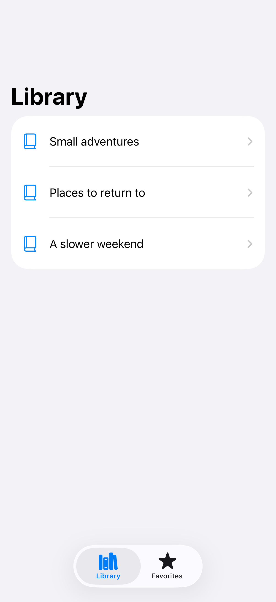

# Independent tab stacks

Each tab can keep its own navigation path while the user switches sections.

## SwiftUI

```swift
import SwiftUI

struct IndependentTabs: View {
    @State private var libraryPath: [String] = []
    @State private var savedPath: [String] = []

    var body: some View {
        TabView {
            Tab("Library", systemImage: "books.vertical") {
                NavigationStack(path: $libraryPath) {
                    NavigationLink("Open book", value: "A good book")
                        .navigationDestination(for: String.self) { Text($0) }
                }
            }
            Tab("Saved", systemImage: "bookmark") {
                NavigationStack(path: $savedPath) {
                    NavigationLink("Open note", value: "A saved note")
                        .navigationDestination(for: String.self) { Text($0) }
                }
            }
        }
    }
}
```

## Captures

<!-- captures:start -->
### iPhone 18 Pro · iOS 27.0

default. light appearance; Large text; en_US.



### iPhone 16 Pro · iOS 18.5

default. light appearance; Large text; en_US.



### iPhone 17 Pro · iOS 26.5

default. light appearance; Large text; en_US.


<!-- captures:end -->

## Full example

[Open the complete runnable example](TabNavigationStacksDemo.swift).

## Reference

[Apple: TabView](https://developer.apple.com/documentation/swiftui/tabview).
