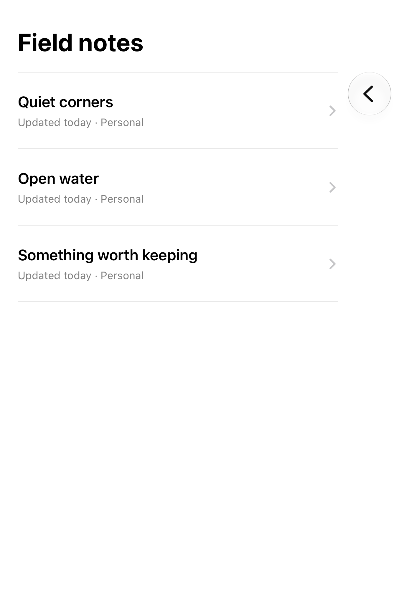
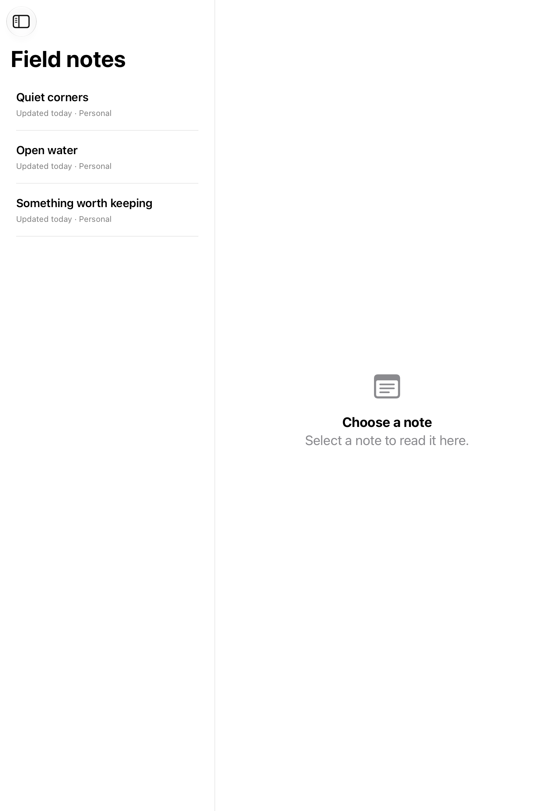

# Three-column navigation

A three-column split view separates collections, items, and the selected detail.

## SwiftUI

```swift
import SwiftUI

struct ThreeColumnLibrary: View {
    @State private var folder: String?
    @State private var note: String?

    var body: some View {
        NavigationSplitView {
            List(["Personal", "Work"], id: \.self, selection: $folder) {
                NavigationLink($0, value: $0)
            }
        } content: {
            if let folder {
                List(["\(folder) notes", "Ideas"], id: \.self, selection: $note) {
                    NavigationLink($0, value: $0)
                }
            }
        } detail: {
            Text(note ?? "Choose a note")
        }
        .onChange(of: folder) { _, _ in note = nil }
    }
}
```

## Captures

<!-- captures:start -->
### iPhone 18 Pro · iOS 27.0

default. light appearance; Large text; en_US.


### iPhone 16 Pro · iOS 18.5

default. light appearance; Large text; en_US.


### iPhone 17 Pro · iOS 26.5

default. light appearance; Large text; en_US.


### iPhone Duo · iOS 27.1

default. light appearance; Large text; en_US.



### iPad Pro 11-inch (M5) · iOS 27.0

Valid portrait adaptation showing content list and intentional empty detail. Sidebar is collapsed; does not establish three simultaneously visible columns.. light appearance; Large text; en_US.


<!-- captures:end -->

## Full example

[Open the complete runnable example](ThreeColumnNavigationDemo.swift).

## Reference

[Apple: NavigationSplitView](https://developer.apple.com/documentation/swiftui/navigationsplitview).
