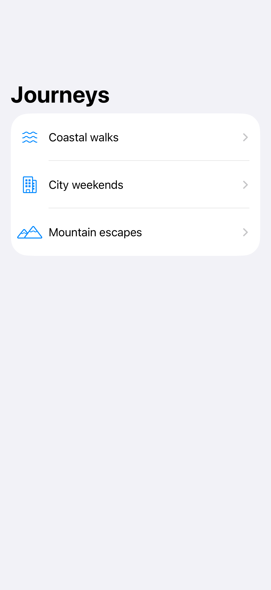
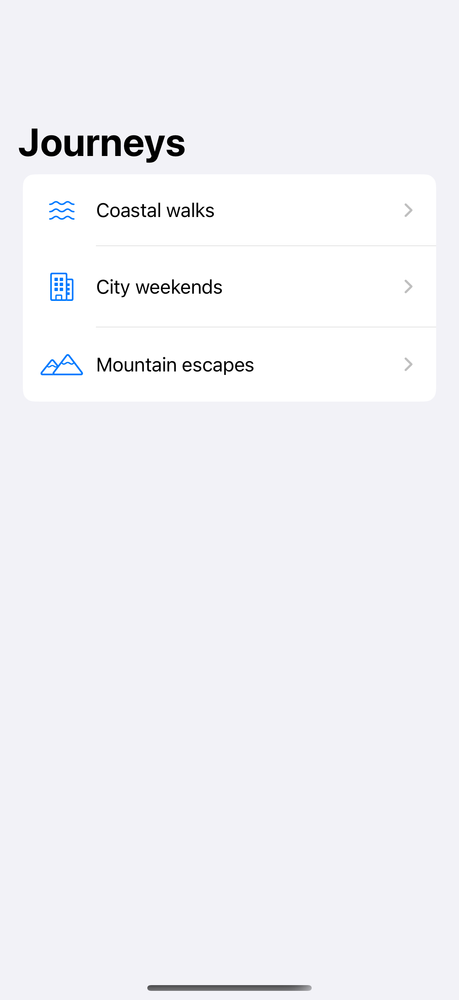
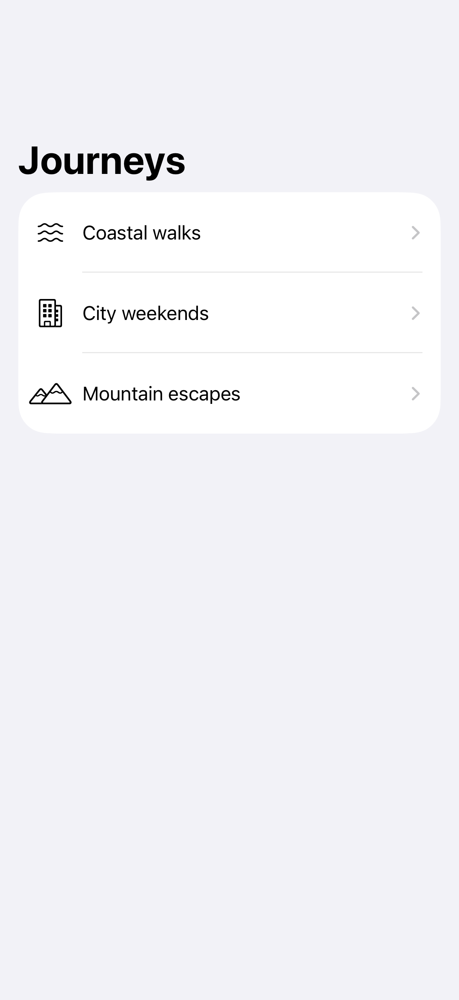
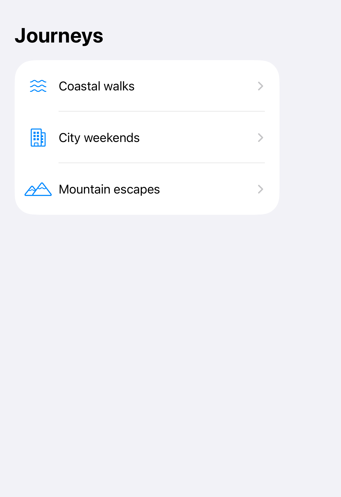
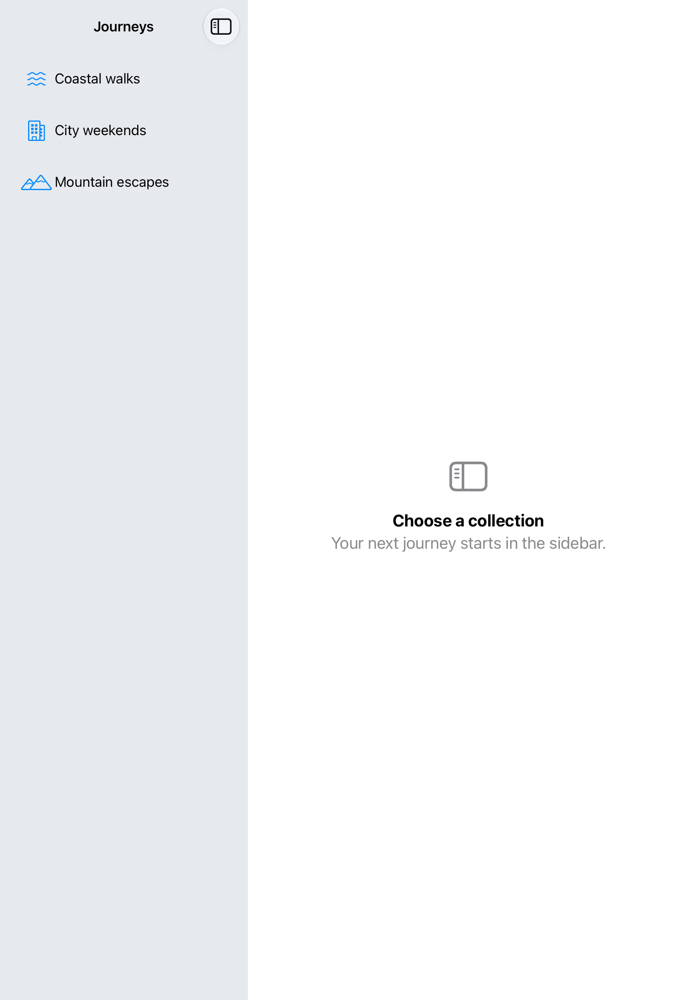

# Two-column navigation

A split view presents a sidebar and a detail destination, collapsing into a stack in compact layouts.

## SwiftUI

```swift
import SwiftUI

struct TwoColumnLibrary: View {
    @State private var selection: String?

    var body: some View {
        NavigationSplitView {
            List(["Travel", "Ideas"], id: \.self, selection: $selection) { title in
                NavigationLink(title, value: title)
            }
            .navigationTitle("Library")
        } detail: {
            if let selection {
                Text(selection)
            } else {
                ContentUnavailableView("Choose a collection", systemImage: "sidebar.left")
            }
        }
    }
}
```

## Captures

<!-- captures:start -->
### iPhone 18 Pro · iOS 27.0

default. light appearance; Large text; en_US.



### iPhone 16 Pro · iOS 18.5

default. light appearance; Large text; en_US.



### iPhone 17 Pro · iOS 26.5

default. light appearance; Large text; en_US.



### iPhone Duo · iOS 27.1

default. light appearance; Large text; en_US.



### iPad Pro 11-inch (M5) · iOS 27.0

Sidebar and intentional empty-detail prompt are both visible. Selected-detail behavior is not established.. light appearance; Large text; en_US.


<!-- captures:end -->

## Full example

[Open the complete runnable example](TwoColumnNavigationDemo.swift).

## Reference

[Apple: NavigationSplitView](https://developer.apple.com/documentation/swiftui/navigationsplitview).
