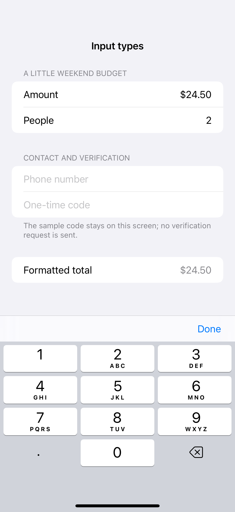
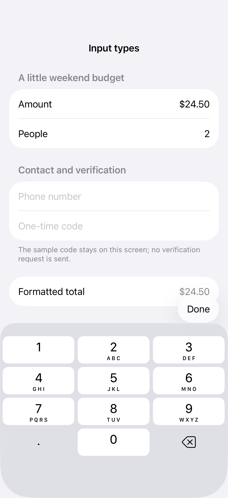

# Formatted values and keyboard types

Value formatting and content types help the keyboard match the kind of information a field expects.

## SwiftUI

```swift
import SwiftUI

struct FormattedAmount: View {
    @State private var amount = 24.50
    @State private var code = ""

    var body: some View {
        Form {
            TextField("Amount", value: $amount, format: .currency(code: "USD"))
                .keyboardType(.decimalPad)
            TextField("One-time code", text: $code)
                .keyboardType(.numberPad)
                .textContentType(.oneTimeCode)
        }
    }
}
```

## Captures

<!-- captures:start -->
### iPhone 16 Pro · iOS 18.5

default. light appearance; Large text; en_US.



### iPhone 17 Pro · iOS 26.5

default. light appearance; Large text; en_US.


<!-- captures:end -->

## Full example

[Open the complete runnable example](FormattedTextInputDemo.swift).

## Reference

[Apple: TextField(value:format:)](https://developer.apple.com/documentation/swiftui/textfield).
