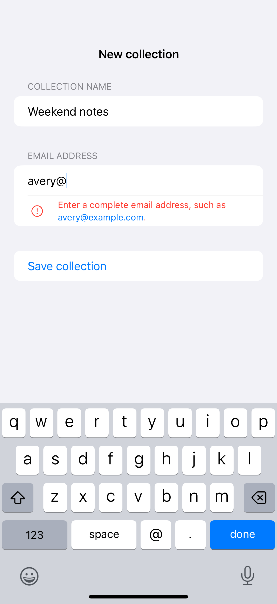

# Inline validation

Field-specific feedback explains what needs attention without discarding the person’s input.

## SwiftUI

```swift
import SwiftUI

struct RequiredField: View {
    @State private var name = ""
    @State private var attempted = false
    private var valid: Bool { !name.trimmingCharacters(in: .whitespacesAndNewlines).isEmpty }

    var body: some View {
        Form {
            TextField("Collection name", text: $name)
            if attempted && !valid {
                Label("Enter a collection name", systemImage: "exclamationmark.circle")
                    .font(.footnote).foregroundStyle(.red)
            }
            Button("Save") { attempted = true }
        }
    }
}
```

## Captures

<!-- captures:start -->
### iPhone 16 Pro · iOS 18.5

default. light appearance; Large text; en_US.


<!-- captures:end -->

## Full example

[Open the complete runnable example](InlineFormValidationDemo.swift).

## Reference

[Apple: TextField](https://developer.apple.com/documentation/swiftui/textfield).
