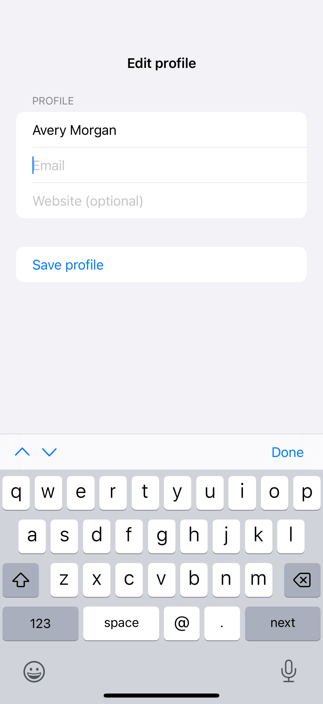

# Focus and submit actions

A focus binding moves between fields while native submit keys and keyboard accessories guide the next step.

## SwiftUI

```swift
import SwiftUI

struct NextFieldForm: View {
    enum Field { case name, email }
    @State private var name = ""
    @State private var email = ""
    @FocusState private var focus: Field?

    var body: some View {
        Form {
            TextField("Name", text: $name)
                .focused($focus, equals: .name)
                .submitLabel(.next)
                .onSubmit { focus = .email }
            TextField("Email", text: $email)
                .keyboardType(.emailAddress)
                .focused($focus, equals: .email)
                .submitLabel(.done)
                .onSubmit { focus = nil }
        }
    }
}
```

## Captures

<!-- captures:start -->
### iPhone 16 Pro · iOS 18.5

default. light appearance; Large text; en_US.


<!-- captures:end -->

## Full example

[Open the complete runnable example](KeyboardFocusFlowDemo.swift).

## Reference

[Apple: FocusState](https://developer.apple.com/documentation/swiftui/focusstate).
