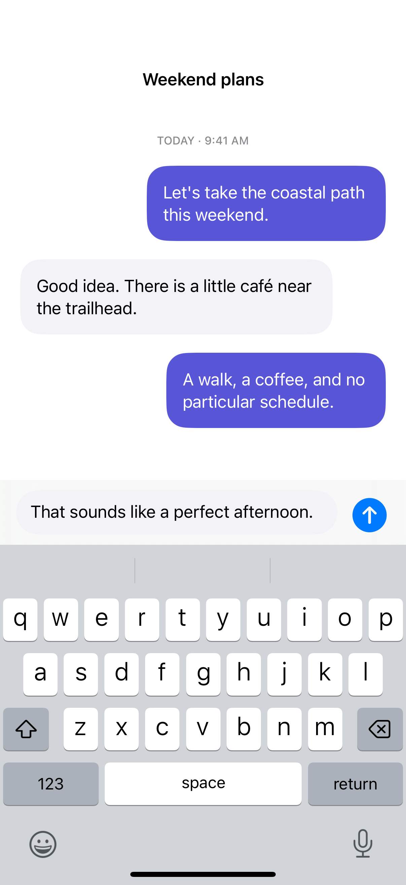

# Keyboard-safe composers

A bottom safe-area inset keeps a composer above the keyboard while the conversation scrolls independently.

## SwiftUI

```swift
import SwiftUI

struct KeyboardAwareComposer: View {
    @State private var draft = ""

    var body: some View {
        ScrollView {
            Text("A conversation lives here.").padding()
        }
        .scrollDismissesKeyboard(.interactively)
        .safeAreaInset(edge: .bottom) {
            TextField("Message", text: $draft, axis: .vertical)
                .lineLimit(1...4)
                .textFieldStyle(.roundedBorder)
                .padding()
                .background(.bar)
        }
    }
}
```

## Captures

<!-- captures:start -->
### iPhone 16 Pro · iOS 18.5

default. light appearance; Large text; en_US.


<!-- captures:end -->

## Full example

[Open the complete runnable example](KeyboardSafeAreaDemo.swift).

## Reference

[Apple: safeAreaInset](https://developer.apple.com/documentation/swiftui/view/safeareainset(edge:alignment:spacing:content:)).
