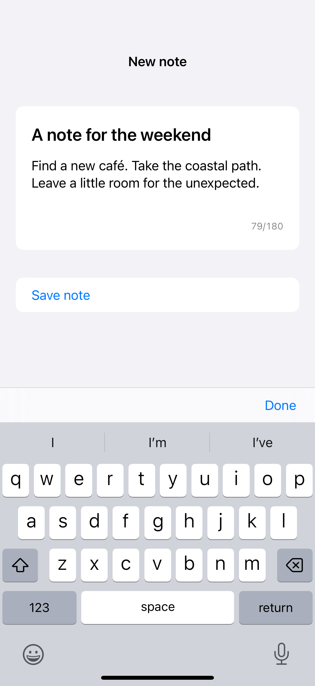

# Multiline text fields

A vertical-axis text field grows through a range of lines before it begins scrolling.

## SwiftUI

```swift
import SwiftUI

struct GrowingNoteField: View {
    @State private var note = ""

    var body: some View {
        VStack(alignment: .trailing) {
            TextField("Write a short note", text: $note, axis: .vertical)
                .lineLimit(3...6)
                .textFieldStyle(.roundedBorder)
            Text("\(note.count)/180").font(.caption)
                .foregroundStyle(note.count > 180 ? .red : .secondary)
            Button("Save") { }
                .disabled(note.isEmpty || note.count > 180)
        }
        .padding()
    }
}
```

## Captures

<!-- captures:start -->
### iPhone 16 Pro · iOS 18.5

default. light appearance; Large text; en_US.


<!-- captures:end -->

## Full example

[Open the complete runnable example](MultilineTextFieldsDemo.swift).

## Reference

[Apple: TextField](https://developer.apple.com/documentation/swiftui/textfield).
