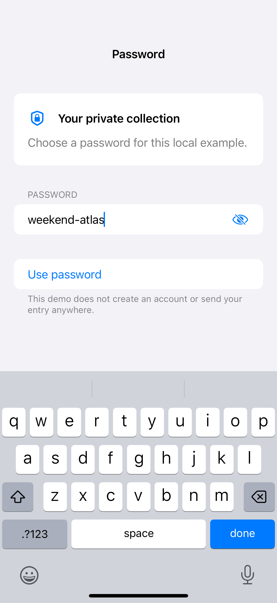

# Password visibility

A secure field obscures a password while an explicit visibility control lets the person check their entry.

## SwiftUI

```swift
import SwiftUI

struct PasswordField: View {
    @State private var password = ""
    @State private var visible = false

    var body: some View {
        HStack {
            Group {
                if visible { TextField("Password", text: $password) }
                else { SecureField("Password", text: $password) }
            }
            .textContentType(.password)
            .textInputAutocapitalization(.never)
            .autocorrectionDisabled()
            Button(visible ? "Hide password" : "Show password",
                   systemImage: visible ? "eye.slash" : "eye") {
                visible.toggle()
            }
            .labelStyle(.iconOnly)
        }
        .padding()
    }
}
```

## Captures

<!-- captures:start -->
### iPhone 16 Pro · iOS 18.5

Local sample password revealed with the visibility control; software keyboard open.. light appearance; Large text; en_US.


<!-- captures:end -->

## Full example

[Open the complete runnable example](SecureFieldVisibilityDemo.swift).

## Reference

[Apple: SecureField](https://developer.apple.com/documentation/swiftui/securefield).
