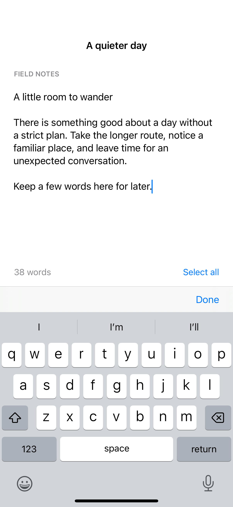

# Text editing and selection

A text editor provides native selection handles and editing menus for longer passages.

## SwiftUI

```swift
import SwiftUI

struct SelectableEditor: View {
    @State private var text = "A little room to wander."
    @State private var selection: TextSelection?

    var body: some View {
        VStack {
            TextEditor(text: $text, selection: $selection)
            Button("Select all") {
                selection = TextSelection(range: text.startIndex..<text.endIndex)
            }
        }
        .padding()
    }
}
```

## Captures

<!-- captures:start -->
### iPhone 16 Pro · iOS 18.5

default. light appearance; Large text; en_US.


<!-- captures:end -->

## Full example

[Open the complete runnable example](TextEditorSelectionDemo.swift).

## Reference

[Apple: TextEditor](https://developer.apple.com/documentation/swiftui/texteditor).
