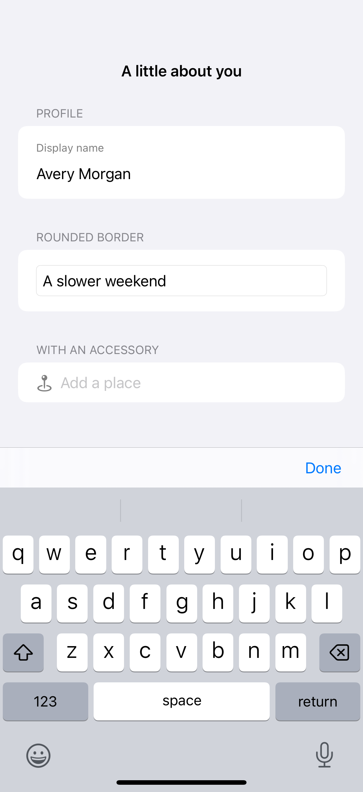

# Text-field styles and labels

Persistent labels remain visible while a person enters text, and field styles establish the editing surface.

## SwiftUI

```swift
import SwiftUI

struct LabeledTextField: View {
    @State private var name = ""

    var body: some View {
        VStack(alignment: .leading, spacing: 8) {
            Text("Display name").font(.caption).foregroundStyle(.secondary)
            TextField("Your name", text: $name)
                .textContentType(.name)
                .textFieldStyle(.roundedBorder)
        }
        .padding()
    }
}
```

## Captures

<!-- captures:start -->
### iPhone 16 Pro · iOS 18.5

default. light appearance; Large text; en_US.


<!-- captures:end -->

## Full example

[Open the complete runnable example](TextFieldStylesDemo.swift).

## Reference

[Apple: TextField](https://developer.apple.com/documentation/swiftui/textfield).
